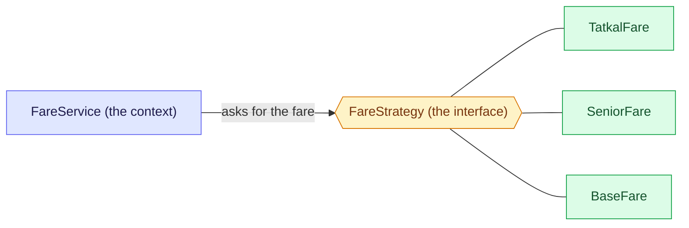

# 2. Strategy: replace the if/else with one class per way

Strategy puts each way of doing one job in its own class behind one interface, so the caller picks one at run time instead of branching on a flag. Unsure of a word? See the [glossary](/notebook/system-design/pattern/lld/glossary).

## Step 1: the smell

This is how the train fare is calculated today. The numbers are made up, not real railway rules.

```java
public int fare(Booking b) {
    if (b.tatkal()) {
        return b.baseFare() * 130 / 100;      // 30% surcharge
    } else if (b.senior()) {
        return b.baseFare() * 60 / 100;       // discount
    }
    return b.baseFare();
}
```

Next month a ladies quota and a rail-pass fare arrive, and the month after that, another rule.

What hurts:

- Every new rule edits this same method, so everyone's change lands in one place and conflicts.
- Every test has to walk all the branches, and a fix to one rule can break another.
- The method keeps growing, and nobody can tell which rule applies without reading all of it.

## Step 2: the idea

Take each branch out into its own class. Give all of the classes the same interface. The caller holds only the interface and asks it for the fare, so the caller has no `if/else` left. A new rule is a new class, and the old classes are not edited.



Three parts have names. The **context** is the caller that needs a fare. The **strategy** is the interface. The **concrete strategies** are the classes, one per rule. The caller knows only the interface, so which class answers can change without touching the caller. The diagram does not show who picks the class, and that is Step 4.

## Step 3: the interface and one concrete strategy

Written in `playground/lld/strategy-pattern`, in plain Java with no Spring annotations yet:

```java
public interface FareStrategy {
  public int getFare(Booking booking);
}

public class TatkalFare implements FareStrategy {
  @Override
  public int getFare(Booking book) {
    return book.baseFare() + (int) (book.baseFare() * 0.3);
  }
}
```

Checked by running it: a base fare of 1000 gives 1300.

The first version had `book.baseFare() * (30 / 100)`. Both numbers are `int`, so `30 / 100` is integer division, which drops the fraction and gives 0. The surcharge was always zero, and a base fare of 1000 came back as 1000. Two safe ways to write it: multiply before dividing (`baseFare * 130 / 100`), or use `0.3` and cast back to `int`, as above.

## Step 4: let each strategy say when it applies

The first `FareService` was correct, but the `if/else` had only moved into it, and it did `new` on every concrete class. A new rule would still have meant editing `FareService`. The fix is to ask each strategy whether it applies.

```java
public interface FareStrategy {
  boolean appliesTo(Booking booking);   // new: the strategy says when it is the right one
  int getFare(Booking booking);
}

@Service
public class FareService {
  private final List<FareStrategy> strategies; // every FareStrategy bean, sorted by @Order

  public FareService(List<FareStrategy> strategies) { this.strategies = strategies; }

  public int fare(Booking booking) {
    return strategies.stream()
        .filter(s -> s.appliesTo(booking))
        .findFirst()
        .orElseThrow()
        .getFare(booking);
  }
}
```

Each concrete strategy is a `@Component` with an `@Order`: `TatkalFare` is 1, `SeniorFare` is 2 and `BaseFare` is 3. Spring injects the `List` already sorted by `@Order`. `BaseFare.appliesTo` always returns true, so it has to be last: the first match wins.

Checked through a real Spring context with a base fare of 1000:

| Booking | Fare |
|---|---|
| plain | 1000 |
| senior | 600 |
| Tatkal | 1300 |
| both | 1300 (Tatkal is first in the order) |

## Step 5: add a rule and see what changes

We added a rail-pass fare (half the base fare, an example number). It took one new class, `RailPassFare`, and one new field, `railPass`, on `Booking`. `FareService` was not edited.

The first run was wrong. `RailPassFare` had `@Order(20)`, but the others were 1, 2 and 3, so it sorted after `BaseFare`, which always applies. A rail-pass booking came back as 1000, not 500. With consecutive numbers there is no whole number between 1 and 2, so inserting a rule forced a renumbering. We changed the numbers to Tatkal 10, rail pass 20, senior 30 and base 100. Only the `@Order` numbers changed in the three older classes.

| Booking (base fare 1000) | Fare |
|---|---|
| plain | 1000 |
| senior | 600 |
| Tatkal | 1300 |
| rail pass | 500 |
| rail pass and senior | 500 (rail pass comes first) |
| Tatkal and rail pass | 1300 (Tatkal comes first) |

Lesson: leave gaps in the order numbers (10, 20, 30) and keep the catch-all default far at the end, so the next rule slots in without touching the old ones.
