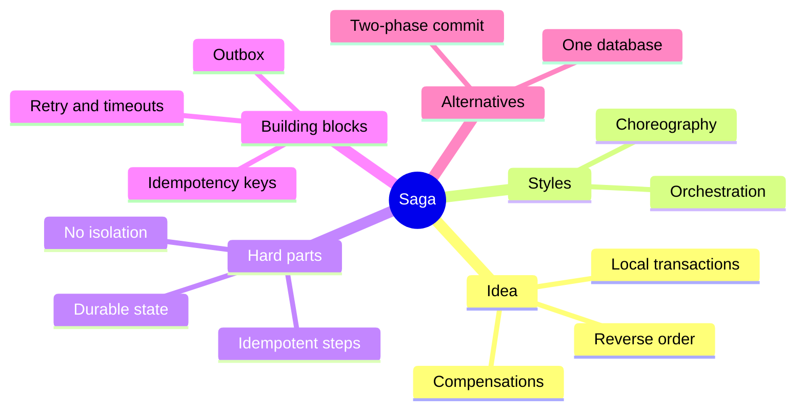
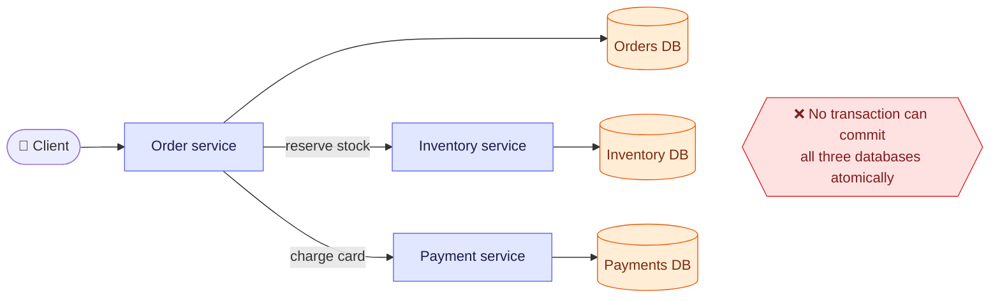
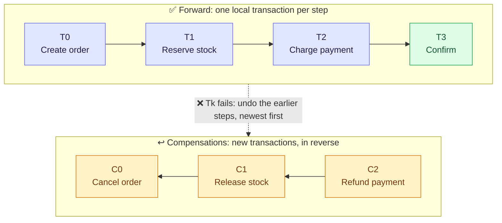
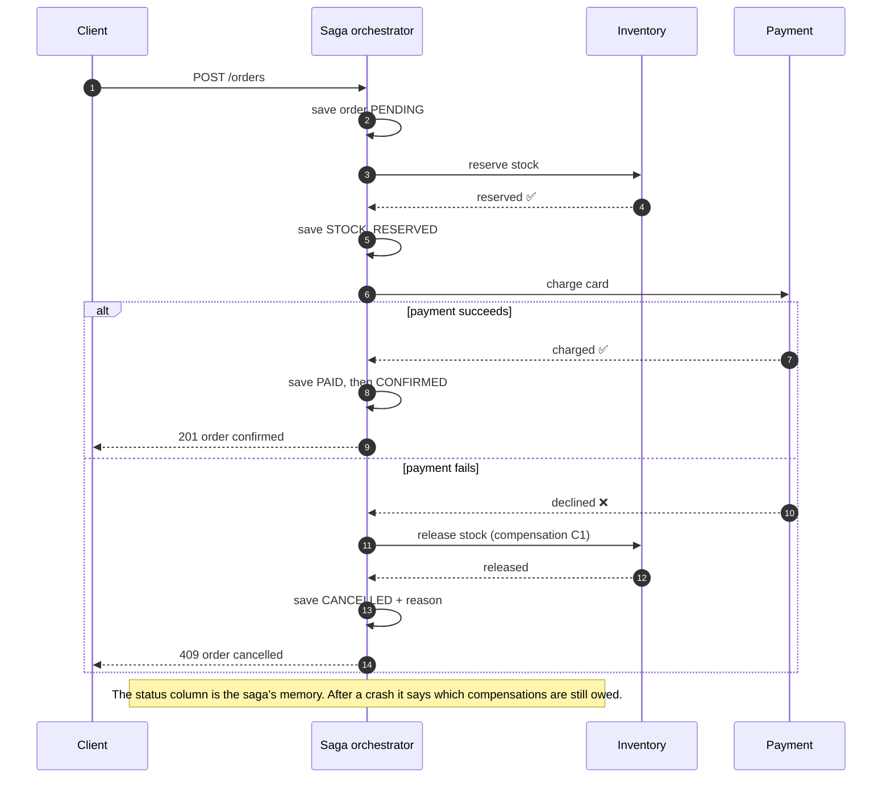
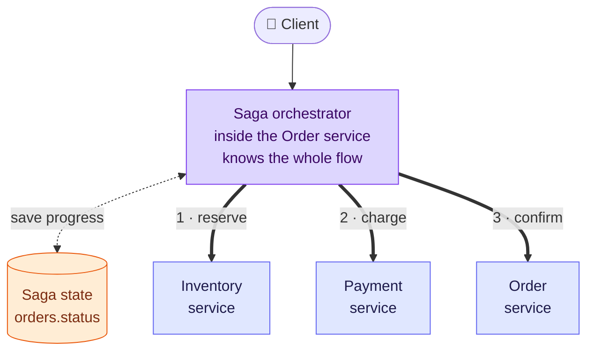
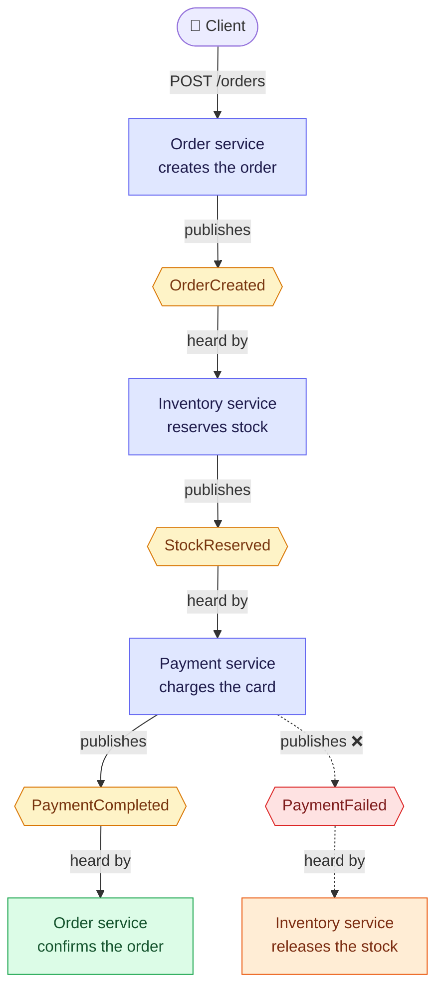
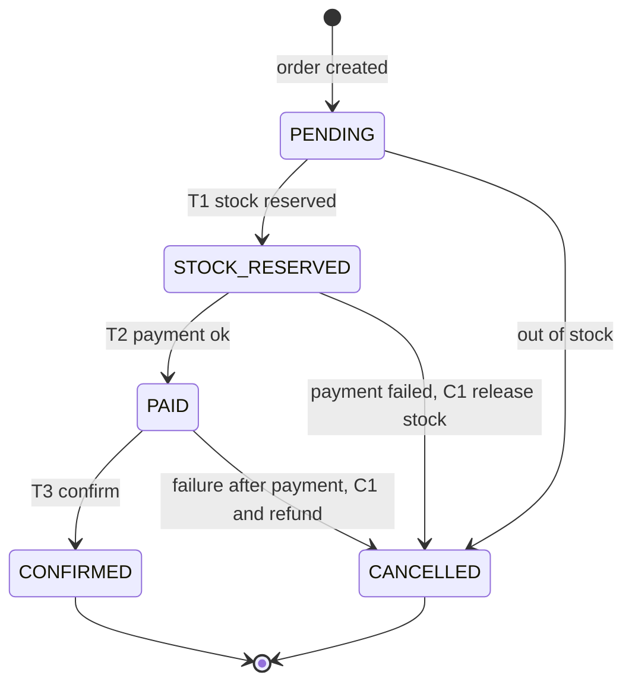
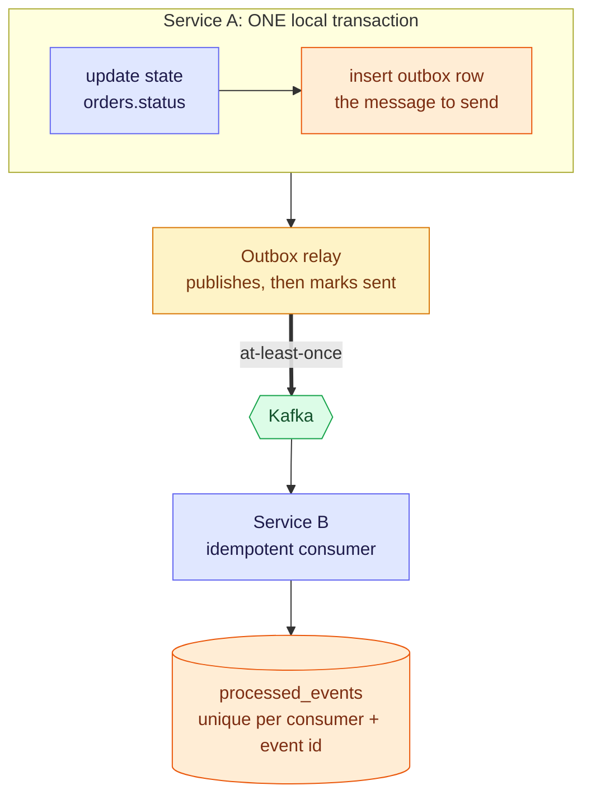
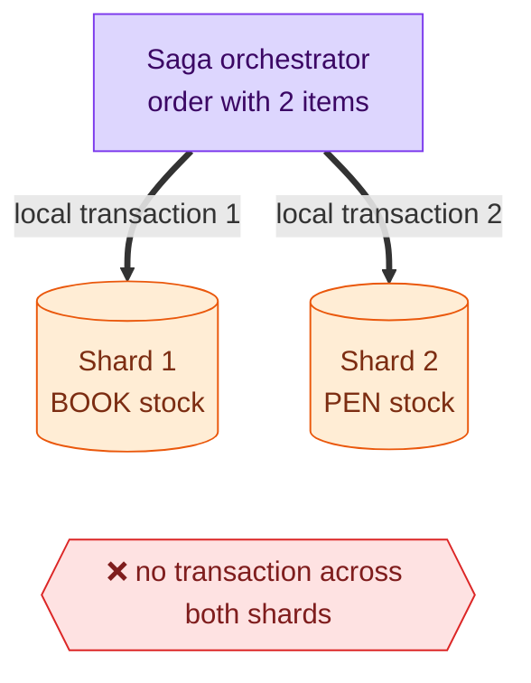
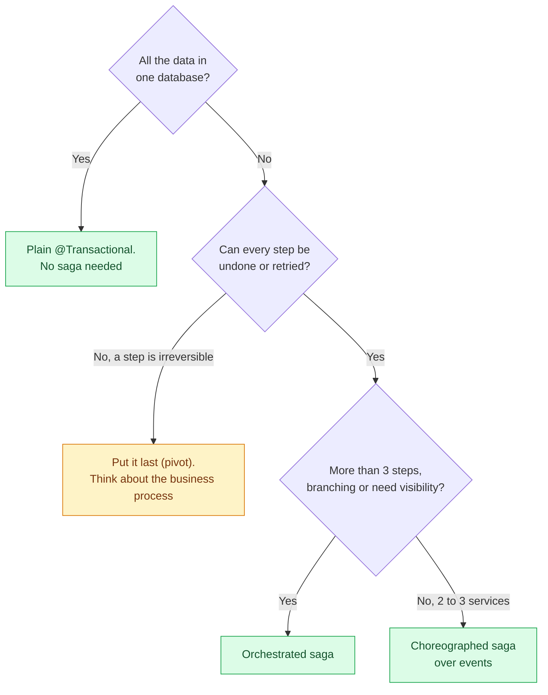

# Saga Pattern — Distributed Transactions Without Two-Phase Commit

A saga replaces **one big transaction** with a **chain of small local ones**, each paired with an
undo. When a step fails halfway you do not roll back; you **compensate**: run the undos of the
steps that already committed, in reverse order. Every saga decision is really one question: *what
does each step's undo look like, and who remembers how far we got?*

> [!TIP]
> **TL;DR: the 30-second interview answer**
> - **Problem:** an order touches stock, payment and the order itself, owned by different services and databases. **No single ACID transaction** spans them, and **2PC** is blocking and unsupported by Kafka or an HTTP payment gateway.
> - **Saga:** a sequence of **local transactions** T1..Tn, each with a **compensation** C. If Tk fails, run C(k-1)..C1 in reverse. You get **eventual consistency**, not isolation.
> - **Two styles:** **orchestration** (one coordinator owns the state machine and tells each service what to do) or **choreography** (services react to each other's events). Both need **idempotent steps**, **durable state** and reliable messaging (**outbox**).

## The landscape at a glance



## The problem: three owners, no shared transaction

Placing an order needs three things. Each lives in a different service with **its own database**:



`@Transactional` only covers **one** database connection. So this happens:

| Time | What happens | State of the world |
|------|--------------|--------------------|
| t1 | Stock reserved (inventory commits) | 1 item gone from stock ✅ |
| t2 | Card charge **fails** (declined, gateway down) | Order cannot complete ❌ |
| t3 | Nobody undoes t1 | **Stock stays reserved forever**: a phantom sale |

Without a saga there is no one whose job it is to fix t3.

### Why not two-phase commit (2PC)?

2PC makes every participant *prepare* (lock and vote), then a coordinator says *commit* to all. It
gives atomicity, but it is **blocking** (locks are held while waiting), a coordinator crash leaves
participants **in doubt**, and it needs every resource to speak XA. A REST payment gateway or a
Kafka topic does not. It also multiplies downtime, because **all participants must be up**:

$$
A_{2PC} = \prod_i a_i
$$

Three services at 99.9% each: $A = 0.999^3 \approx 99.7\%$, about **26 h** of downtime a year,
against **8.8 h** for one service. A saga lets each service commit alone, so one slow or dead
participant does not hold locks in the others.

## Mental model: a chain of steps, each with an undo



Read the dashed arrow: a failure at step Tk starts the undo at C(k-1) and walks **backwards**: if T2
(charge) fails, run C1 then C0; if T3 (confirm) fails, run C2, C1, C0. The saga does **not** erase
the earlier steps. It runs **new transactions** that semantically cancel their effect. Between T1 and C1 the world briefly shows a reserved item
that will never ship. A saga is **ACD**, not ACID: atomic (eventually), consistent (eventually),
durable, but **not isolated**.

### Our example, step by step

| # | Step (local transaction) | Compensation | Order status after |
|---|--------------------------|--------------|--------------------|
| T0 | Insert the order | Mark it `CANCELLED` | `PENDING` |
| T1 | Reserve stock: `UPDATE inventory SET available = available - n WHERE sku = ? AND available >= n` | Release stock: `available + n` | `STOCK_RESERVED` |
| T2 | Charge the payment gateway | Refund | `PAID` |
| T3 | Mark the order confirmed | none, the saga is complete | `CONFIRMED` |

The guarded `UPDATE` in T1 matters: the check and the decrement are **one atomic statement**, so
two orders racing for the last item cannot both win.

## How it works: the orchestrated flow



Steps 2, 5, 8 and 13 are the point: the orchestrator writes down **how far it got** after every step,
because that record is the only thing that tells a restarted process what to undo.

## Two styles: orchestration vs choreography

### Orchestration: one coordinator decides



The orchestrator is the **only** place that knows the whole flow. Each arrow is a command, and the
participant answers success or failure. The flow reads top to bottom in **one class**, and its
progress is saved after every step.

### Choreography: services react to events



Nobody owns the flow: the hexagons are events on Kafka, and each service listens for the one it
cares about and publishes the next. Compensation is also an event: `PaymentFailed` makes Inventory
release the stock **by itself**. (Inventory and Order appear twice because they act twice, at
different points of the flow.)

### Compared

| | **Orchestration** | **Choreography** |
|---|---|---|
| Who knows the flow | One coordinator | Nobody, it emerges from the events |
| Coupling | Coordinator knows every participant | Services know only the events |
| Adding a step (fraud check) | ✅ Change one place | ⚠️ Rewire several listeners |
| Seeing "where is order 42?" | ✅ Read its saga state | ⚠️ Stitch together events from several topics |
| Cyclic dependencies | Unlikely | ⚠️ Easy to create by accident |
| Single point of failure | ⚠️ The coordinator (keep it stateless over a durable store) | None |
| Use when | 4+ steps, branching, need for visibility | 2 to 3 services, simple linear flow |

## Designing the compensation

A compensation is a **business-level undo**, not a database rollback. Three kinds of step matter:

| Kind | Meaning | Example | Rule |
|------|---------|---------|------|
| **Compensable** | Can be undone by a later transaction | Reserve stock, create order | Put it **before** the point of no return |
| **Pivot** | The go or no-go step: once it succeeds the saga must run to the end | Charging a card you cannot refund, shipping goods | Exactly one, as late as possible |
| **Retriable** | After the pivot, guaranteed to complete if retried | Mark confirmed, send the receipt | Must be **idempotent**, retried until it works |

> [!IMPORTANT]
> **Order the steps so the hardest-to-undo one comes last.** Reserve stock (easy to undo) before
> charging the card (annoying to undo) before sending the email (impossible to undo). A step that
> cannot be undone belongs after every step that can still fail.

> [!WARNING]
> **A compensation can fail too.** If "release stock" throws because Inventory is down, you cannot
> shrug and move on. It must be **retried** (with backoff) until it succeeds, so it must be
> **idempotent**, and the saga stays visibly in a *compensating* state until it does.

## State machine: the saga's memory



Every arrow into `CANCELLED` is a **different** compensation: from `PENDING` nothing was taken, from
`STOCK_RESERVED` the stock goes back, from `PAID` the stock goes back **and** the money must be
refunded. The compensation therefore **reads the current status** to know what to undo, which also
makes running it twice harmless.

## Making it reliable: three things that go wrong



| Failure | What goes wrong | Answer |
|---------|-----------------|--------|
| **Crash between "save state" and "send message"** (dual write) | State says reserved, nobody was told | **Transactional outbox**: state and message in one local transaction, a relay publishes |
| **The same message arrives twice** (at-least-once delivery) | Stock reserved twice, card charged twice | **Idempotent consumer** and **idempotency keys** (use the order id as the key for the payment call) |
| **The orchestrator dies mid-saga** | Half-done order nobody finishes | **Persisted status** plus a recovery job that resumes or compensates orders stuck too long |

### When the compensation itself fails

`cancel` is a database transaction too. If the database is down while it runs, the order stays in its
last status (say `STOCK_RESERVED`) and the stock stays held. A message queue does **not** fix this
case: a retry message would be written through an outbox row **in the same database that is down**.

> [!IMPORTANT]
> **The saved status is the retry queue.** `STOCK_RESERVED` was committed *before* the failure, so it
> survives. A scheduled **recovery job** finds orders that have been unfinished for longer than a
> threshold and runs `cancel` again. That is safe because `cancel` reads the status first, and it
> works for an outage, a crash and a deploy mid-saga. If the database is still down, the job fails
> and tries again on its next tick.

A queue becomes the right tool when the compensation belongs to **another service**: the orchestrator
sends "release stock" through the outbox, Kafka holds the message while that service is down, and its
idempotent consumer applies it once.

Rules for the recovery job:

| Rule | Why |
|------|-----|
| The threshold must be **longer than the slowest normal saga** | Otherwise the job cancels an order that is still being paid |
| Ask the payment service before cancelling, using the order id as an **idempotency key**, or refund | A crash after a real charge but before `markPaid` would otherwise cancel an order the customer paid for |
| After N failed attempts, **alert** instead of looping | A compensation that can never succeed needs a human |

### No isolation: what other readers can see

Between T1 and C1 other transactions can read the reserved stock. This is the price of sagas.
Standard countermeasures:

| Countermeasure | Idea | Example |
|----------------|------|---------|
| **Semantic lock** | Mark the record as "in flux" | Order status `PENDING`: other code treats it as not final |
| **Commutative updates** | Make steps order-independent | `available - n` and `available + n` can run in any order |
| **Pessimistic view** | Reorder steps to reduce exposure | Reserve stock before anything customer-visible |
| **Reread value** | Re-check a value before overwriting it | Optimistic lock with `@Version` on the order |

## Saga compared with its neighbours

| Option | How | Consistency | Main risk | Use when |
|--------|-----|-------------|-----------|----------|
| **Plain `@Transactional`** | One DB, one transaction | ✅ Strong (ACID) | None | ✅ All the data is in **one** database |
| **2PC / XA** | Coordinator prepares then commits all | Strong | ⚠️ Blocking, in-doubt, needs XA everywhere | Few resources that all support XA |
| **Saga** | Local transactions plus compensations | Eventual, no isolation | Compensation bugs, visible intermediate state | ✅ Business process across services |
| **Outbox** | State and message in one local transaction | n/a | Duplicates (at-least-once) | A **building block** of a saga, not an alternative |

## Sagas and sharding: who owns the data?

When the data outgrows one database it is split (**sharded**) across several, usually by a key such as
the product or branch id. A guarded update stays safe as long as each piece of stock has **one owner**.
A saga is needed when one business operation changes data owned by **more than one** owner.



Each reservation is still a local transaction on its own shard. What is missing is one transaction
over both, so "reserve the book, reserve the pen, and undo the first if the second fails" is a saga.

| Situation | Is the guarded `UPDATE` enough? |
|-----------|---------------------------------|
| Each stock row lives in one shard (sharded by product, or by branch plus product) | ✅ Yes: one row, one lock, the last-item race stays safe |
| Read replicas for scale | ✅ For reservations, because writes go to the primary. Never reserve against a replica, which may be behind |
| A cart whose items live on different shards, or an order on one shard and its stock on another | ⚠️ No: it crosses databases, so use a saga (or 2PC) |
| Several primaries in different regions writing the same product | ⚠️ No, unless each product has one "home" region that takes all its writes |

> [!IMPORTANT]
> **Our saga exists because of the payment service, not because of one database.** A payment gateway
> can never join a database transaction. Keeping order and stock in one database only made the stock
> part a single local transaction; once the data is sharded, that part becomes a saga step too.

### Hot rows

One popular product (a flash sale, a concert ticket) turns its stock row into a queue: every writer
waits on the row lock, so that row's throughput is about one divided by the time the lock is held, and
the waiting requests keep their database connections until the pool runs out. Ways to relieve it
*(from knowledge, not tested here)*: keep the locked section as short as ours (one statement); split
the stock into several rows in the same shard; or put an atomic counter in Redis in front while the
database stays the source of truth and the final guard. That last option is the cache topic that
comes next.

## Choosing



## In Spring Boot

There is no `@Saga` annotation in Spring itself. A saga is **a few ordinary Spring pieces** arranged
carefully:

| Saga part | Spring piece |
|-----------|--------------|
| Local transaction per step | A `@Transactional` method, **each in a bean other than the orchestrator** |
| Saga state | A JPA entity with a status column (`OrderEntity`, `OrderStatus`) |
| Orchestrator | A plain `@Service` that calls the steps in order and catches failure |
| Recovery of stuck sagas | A `@Scheduled` job (needs `@EnableScheduling`) that reads orders by status with a derived query, `findByStatusInAndCreatedAtBefore`, and calls `cancel` again |
| Reliable messages | Transactional outbox plus `@KafkaListener` (idempotent consumer) |
| Call to the payment service | `RestClient` with `@Retryable` and a circuit breaker |
| Workflow engines (named from memory, not used here) | Spring State Machine, Axon sagas, Temporal, Camunda |

```java
// The steps live in their OWN bean: the orchestrator calls them through the Spring proxy,
// so each call gets its own transaction and commits alone (a call inside one class would skip the proxy).
@Service
public class OrderSteps {

    @Transactional public Long createOrder(String sku, int quantity) { /* insert PENDING */ }
    @Transactional public void reserveStock(Long orderId)            { /* guarded UPDATE, then STOCK_RESERVED */ }
    @Transactional public void markPaid(Long orderId)                { /* PAID */ }
    @Transactional public void confirm(Long orderId)                 { /* CONFIRMED */ }

    // The compensation reads the status to know what to undo, so running it twice is harmless.
    @Transactional public void cancel(Long orderId, String reason)   { /* release stock if reserved, then CANCELLED */ }
}
```

The orchestrator has one job: call the steps in order and, on any exception, call `cancel`. The
payment call sits **between** two transactions, never inside one, so no database lock is held while
waiting for an external system.

### What we built and verified (`playground/saga-pattern`)

Built: the `V1` tables `orders` and `inventory`, `OrderEntity` and `OrderStatus`, `InventoryRepository`
(guarded `reserve` and `release`), `OrderSteps`, the orchestrator `OrderSagaOrchestrator`, a toy
`PaymentGateway` with modes `OK`, `DECLINE` and `DOWN` (flipped with `PUT /demo/payment-mode`),
`POST /orders` (201 when `CONFIRMED`, 409 when `CANCELLED`) and the `OrderRecoveryJob`.

| Experiment | Result *(all reproduced)* |
|------------|---------------------------|
| Order 2 books, gateway `OK` | 201 `CONFIRMED`, stock 10 to 8 |
| Gateway `DECLINE`, order 2 books | 409 `CANCELLED` "card declined". Log: created, stock reserved, charging, "compensating", `CANCELLED`. The stock came back: 4 declined orders had held 8 books, and 4 later orders could still be confirmed |
| Order 50 books | 409 `CANCELLED` "Not enough stock of BOOK for 50". No "stock reserved" and no payment line: nothing to compensate |
| Hard-kill the app between reserve and payment (temporary 10 s sleep in the gateway) | Order left in `STOCK_RESERVED`, stock 8 instead of 10. About 40 s later, after the restart, the recovery job (threshold 20 s in dev) cancelled it and the stock was 10 again |
| Two clients, last book (temporary 3 s sleep inside the reserve transaction) | Client A: 201 `CONFIRMED`. Client B waited about 3.04 s on the row lock, then matched 0 rows: 409 out of stock. Final stock 0, never negative |

The invariant that held throughout: **stock + quantity of confirmed orders = starting stock**, and no
order was left in `PENDING`, `STOCK_RESERVED` or `PAID` once the job had run.

> [!WARNING]
> **Not built or not tested.** Gateway mode `DOWN` was never exercised. There is no refund step: a
> `PAID` order that gets cancelled only logs a warning. The recovery job does not ask the payment
> service before cancelling, and nothing stops the job and a slow saga from acting on the same order
> (a lock or lease would). There is no alert after repeated failures, and the outbox and Kafka part
> of the pattern is not built here.

## Pitfalls

> [!WARNING]
> **Compensation is not rollback.** The first transaction already committed and other readers saw
> it. Design for the visible middle: a status such as `PENDING`, not a silent half-state.

> [!CAUTION]
> **Never call another service inside the local database transaction.** The row locks are held for
> the whole network call, a timeout leaves the outcome unknown, and the transaction can still roll
> back after the remote side committed. Commit, then call.

| Symptom | Cause | Fix |
|---------|-------|-----|
| Stock reserved for orders that never complete | No compensation for a failed later step | Add the undo, run it on **every** failure path |
| Customer charged twice | Duplicate message or a retried call without an idempotency key | Key the payment by order id, idempotent consumer |
| Orders stuck in `STOCK_RESERVED` after a deploy | Orchestrator died mid-saga, nothing resumes | Persisted status plus a recovery job with a timeout |
| Compensation runs twice, stock released twice | Undo is not guarded | Check the status inside the same transaction as the release |
| Two sagas fight over the last item | No isolation | Atomic guarded `UPDATE`, semantic lock status |
| Cannot tell where an order is | Choreography across many topics | Keep a saga state table or move to orchestration |

## Interview questions

<details>
<summary>Stock was reserved, then the card is declined. Walk through exactly what runs and what the customer sees.</summary>

The orchestrator catches the failure of the payment step and runs the compensations of every step
that had committed, in reverse: **release the stock**, then mark the order `CANCELLED` with a reason.
Both happen in one local transaction so a crash cannot leave one without the other. The customer
gets a clear "payment failed" response; for a short time between the reservation and the release,
the item looked reserved to other buyers, which is the missing isolation of a saga.
</details>

<details>
<summary>The compensation "release stock" throws because the inventory database is down. What do you do?</summary>

You do not drop it. A compensation must **eventually succeed**, so retry it with exponential backoff
and jitter, and keep the order in a visible compensating state. This is why every compensation must
be **idempotent**: a retry, or a retry after a crash, must not release twice. If retries are
exhausted, raise an alert and park the saga for manual repair rather than losing the obligation.
</details>

<details>
<summary>The orchestrator charged the card, then crashed before saving PAID. After the restart, how do you avoid charging twice?</summary>

Two layers. **Persisted state** tells the recovery job the order is still `STOCK_RESERVED`, so it
will retry the charge. The charge call carries an **idempotency key** (the order id), so the payment
service recognises the duplicate and returns the earlier result instead of charging again. Without
the key, recovery would double-charge; without persisted state, nobody would retry at all.
</details>

<details>
<summary>Why not wrap order, inventory and payment in one distributed transaction (2PC)?</summary>

2PC holds locks in every participant while it waits for the slowest one, a coordinator crash leaves
participants in doubt, and every resource must support XA (a REST gateway and Kafka do not). It also
requires all participants to be up at the same time, so availability multiplies down. A saga trades
atomicity for availability: each service commits locally and failures are repaired by compensation.
</details>

<details>
<summary>You have a choreographed saga over six services and product asks for a fraud check between payment and confirmation. Why is that painful?</summary>

In choreography the flow exists only in the wiring: Payment publishes `PaymentCompleted`, Order
listens for it. To insert a step you change what Payment publishes, add a new listener and
rewire Order, and failure events have to be rewired too. It is easy to create a cycle or to forget a
compensation. With **orchestration** the flow is one class, so you add a step and its compensation
in one place.
</details>

<details>
<summary>Two customers order the last item at the same moment. A saga has no isolation, so what stops both from getting it?</summary>

The reservation step is a single guarded statement, `UPDATE inventory SET available = available - n
WHERE sku = ? AND available >= n`, which checks and decrements **atomically**. The row lock makes
the second statement see the first one's result, so it updates zero rows and that order fails at
step one with nothing to compensate. This is a **commutative, atomic local step**; the order's
`PENDING` status is a **semantic lock** that tells the rest of the system it is not final yet.
Reproduced here by holding the reserve transaction open for 3 s: the second client waited about
3.04 s on the row lock, then matched zero rows and failed cleanly. `@Transactional` alone would not
help if the code read the stock, checked it in Java and then wrote it back.
</details>

<details>
<summary>The cancel step throws because the database is down. A teammate says to add Kafka and retry through a topic. What do you answer?</summary>

Kafka does not help with this failure. A retry message has to be recorded somewhere durable, usually
an outbox row, and that row lives in the same database that is down. What is already durable is the
order's **status**, committed before the failure. A scheduled recovery job reads orders that are still
`PENDING`, `STOCK_RESERVED` or `PAID` after a threshold and runs the idempotent `cancel` again; if the
database is still down it fails and retries on the next tick. A queue is right when the compensation
belongs to **another service** that may be down.
</details>

<details>
<summary>The recovery job cancels an order whose customer was actually charged. How can that happen and how do you prevent it?</summary>

The app crashed after the payment service charged the card but before `markPaid` saved it, so the
order is still `STOCK_RESERVED` and the job cancels it. Prevent it by sending the order id as an
**idempotency key** with the charge and asking the payment service for that key's result before
cancelling, or by refunding when the order had been charged. The job's age threshold must also be
longer than the slowest normal saga, or it will cancel an order that is still in flight.
</details>

<details>
<summary>Your inventory is sharded by product and an order contains a book and a pen on different shards. Does the guarded stock update still protect you, and what else do you need?</summary>

For each item, yes: a row has one owner and one lock, so the check and decrement of that item stay
atomic. But no transaction spans the two shards, so "reserve both or neither" is a saga: reserve the
book, reserve the pen, and if the second fails run the compensation that releases the first. The
payment service is a third participant that never joins a database transaction anyway.
</details>

## Key takeaways

| Remember | Because |
|---|---|
| A saga is local transactions plus compensations | No single transaction spans several services |
| Compensation is a new business transaction, not a rollback | The first one already committed and was visible |
| Persist the saga's progress after every step | It is the only memory a restarted process has |
| Make every step and compensation idempotent | Messages are at-least-once and compensations get retried |
| Put the hardest-to-undo step last | After it, only retriable steps may remain |
| Orchestrate when the flow is long or branching | Choreography spreads the flow across listeners |
| Never call a remote service inside a DB transaction | Locks held over a network call, and the outcome can be unknown |
| Retry a failed compensation from the saved status | The status survives the outage; a message written to the same database cannot |
| Make the stock check and the decrement one statement | The row lock then decides a race, and the loser fails cleanly |
| Sharding keeps a single-row guard safe, but not an operation across shards | One row has one owner and one lock; an order spanning shards needs a saga |

**Related:** [Transactional outbox](/notebook/spring-boot-system-design/05-distributed-problems/transactional-outbox) · [Idempotency keys](/notebook/spring-boot-system-design/05-distributed-problems/idempotency-keys) · [Kafka with Spring Boot](/notebook/spring-boot-system-design/04-messaging/kafka-with-spring-boot) · [Transactions in Spring](/notebook/spring-boot-system-design/02-persistence/transactions-in-spring) · [Caching](/notebook/system-design/caching)
