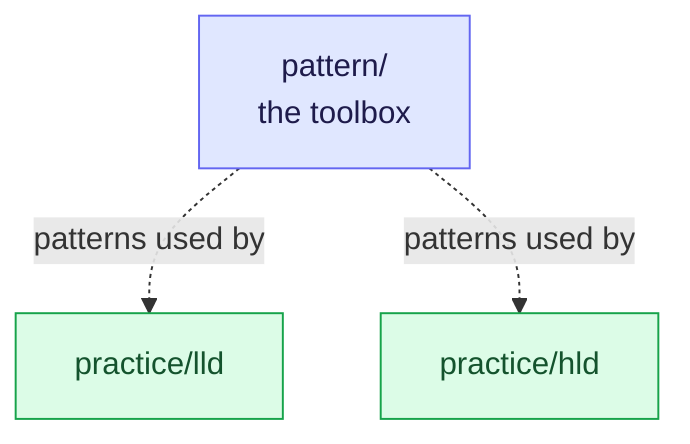

# 1. System design practice: the map

Practice is where finished design drills are filed, one note per problem, split into LLD (classes, patterns, code) and HLD (architecture, data, scale). The `pattern/` folder next to it is the toolbox, and this folder shows the tools used on real problems.

> [!TIP]
> - **`practice/lld/`** holds class-level designs: requirements, classes and interfaces, patterns, concurrency, code.
> - **`practice/hld/`** holds architecture designs: scope, numbers, architecture, flows, API, data model, decisions.
> - **One note per problem.** One problem can have both halves, with the same file name in `lld/` and `hld/`.

## Where things live



The patterns are the tools, and each note in `practice/` shows them applied to one problem.

## Problems

| Problem | Type | Status | Note |
|---|---|---|---|
| Rate limiter | LLD | Requirements and design written. The review step is still open. | [Rate limiter](/notebook/system-design/practice/lld/rate-limiter) |
| Train ticket booking | HLD | Done: scope, numbers, architecture, flows, API, data model and 16 decisions on one canvas | [Design a train ticket booking system](/notebook/system-design/practice/hld/train-ticket-booking) |
| Train ticket booking | LLD | To do: classes, interfaces, patterns and concurrency for seat holds | Not written yet |

## How the problems connect

| From | To | The link |
|---|---|---|
| Train ticket HLD, decision 13 | Rate limiter LLD | The gateway needs a per-user and per-IP sliding-window limit. The rate limiter design is that component at class level. |
| Train ticket HLD, statuses and data model | [LLD patterns: the map](/notebook/system-design/pattern/lld/overview) | The booking and payment states (HELD, CONFIRMED, EXPIRED, CANCELLED) are the State pattern, and the pattern notes tie each pattern back to this system |
| Train ticket HLD, booking flow | [HLD patterns: the map](/notebook/system-design/pattern/hld/overview) | Hold, pay, confirm with a refund as the compensation is the saga pattern |

## Folder layout

```text
system-design/
  caching.md
  pattern/
    lld/        the classic patterns, one note each
    hld/        distributed-system patterns
  practice/
    overview.md this page
    lld/        class-level designs, one note per problem
    hld/        architecture designs, one note per problem
```

One file per problem, named in kebab-case after the problem. The two halves of one problem share the file name, for example `lld/train-ticket-booking.md` and `hld/train-ticket-booking.md`.

**Related:** [LLD patterns: the map](/notebook/system-design/pattern/lld/overview) · [HLD patterns: the map](/notebook/system-design/pattern/hld/overview)
