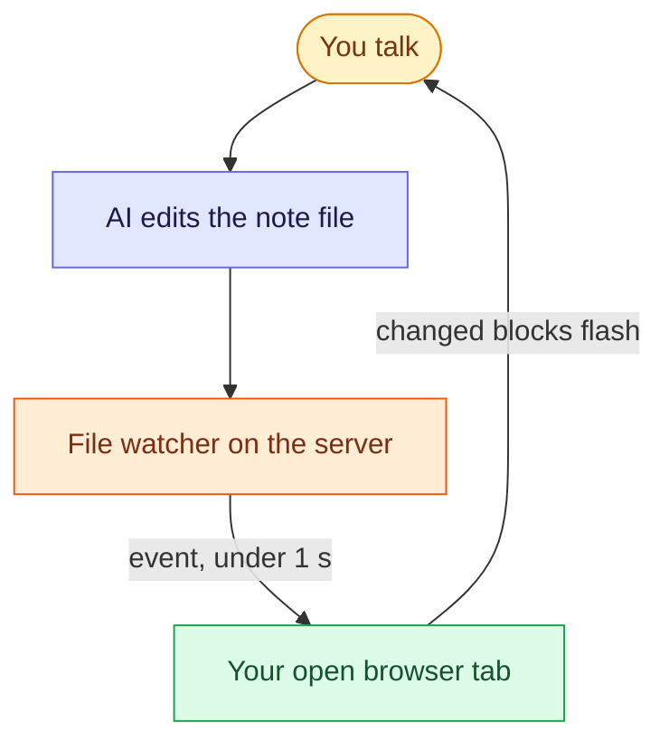

# How the Whiteboard Works

Talk to an AI about a design while it edits one markdown file. The page in your browser redraws itself within a second, with no refresh and no lost place.

> [!TIP]
> - **Notes in `whiteboard/` are boards.** Steps are numbered, diagrams use the full width, and **Follow** is on by default.
> - The AI just **edits the file**. No plugin, MCP server or SDK is involved. A file watcher streams every save to your open tab.
> - Only the **blocks that changed** are replaced, so unchanged diagrams stay drawn and open quiz cards stay open.

## The loop

The tab is a passive screen: you steer by talking, and the file is the only thing that moves.

## Start a session

1. Open the board you want in the Notebook (or ask the AI to create one under `whiteboard/`).
2. Tell the AI what to design, for example *"whiteboard: design a rate limiter, step by step"*.
3. Keep the tab visible next to your chat. Each reply adds or revises one step.

## What you see while it edits

| The AI... | The page... |
|---|---|
| rewords a paragraph | flashes that block once; your scroll position does not move |
| appends a new step | scrolls to it when **Follow** is on |
| writes a diagram with a syntax error | keeps the last good drawing and shows an amber message with the parse error |
| edits the note you have open in the editor | the editor follows the file if you have no unsaved changes, otherwise it asks |
| changes a note while the tab is in the background | refreshes once when you come back |
| is unreachable (server stopped) | shows *Reconnecting…* and catches up when it returns |

> [!NOTE]
> The board is one-way: the AI draws, you read, pan and zoom. Dragging shapes on screen is not saved back to the file.

**Related:** [Design a URL shortener](/notebook/whiteboard/url-shortener) is a finished board to look at.