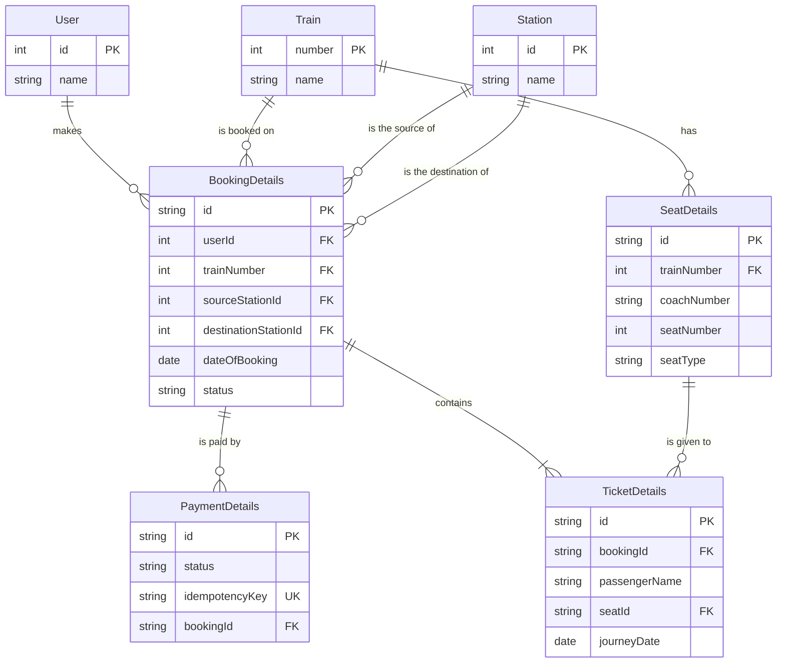

# Design a Train Ticket Booking System

The hard part is not booking one seat. It is thousands of people fighting for the same seat in the same minute, without ever selling it twice or losing a payment.

## Requirements and numbers

### Scope

| Flow | Decision | Why |
|---|---|---|
| Search seat availability | In | The read-heavy path: everybody checks, few book |
| Book a seat: hold, pay, confirm | **In, the core** | Where a seat must never be sold twice and a payment never taken twice |
| Tatkal: the booking flow at the opening minute | **Last, as a non-functional topic** | Your call: the same flow under a burst, handled at the end of the session |
| Cancel and refund | Out for this session | Your call: we only discuss search and booking |
| Accounts and login, timetable admin, waitlist and RAC, fare rules, multi-city trips, notifications beyond one confirmation email | Out | Real, but they would hide the core problem |

### What must hold

- **A seat is never sold twice.** Strong consistency on the seat, even when 100 people click at once.
- **A payment is never taken twice.** The merchant call carries an idempotency key.
- **A held seat expires** if payment does not finish (we pick 5 minutes), so abandoned holds do not block the train.
- **Search shows whether seats are available** (not the exact count), from a shared copy up to 3 minutes old. The guarded hold, not the search, decides whether a seat is really free.
- **Browsing stays up** even when booking is slow or paused.

### Numbers

These are our own assumptions, not real railway data. Change any that look wrong.

| Metric | Estimate | Working |
|---|---|---|
| Trains per day | 1,000 | assumption |
| Seats per train | 1,000 | assumption |
| Seats sold per day | 1M | 1,000 trains × 1,000 seats, every seat sells once |
| Average bookings per second | ≈ 12 | 1M ÷ 86,400 s ≈ 11.6 |
| Availability checks per booking | 100 | assumption: people browse a lot |
| Average reads per second | ≈ 1,160 | 1M × 100 ÷ 86,400 s |
| Users in the first Tatkal minute | 100,000 | assumption |
| Peak attempts per second | ≈ 1,700 | 100,000 ÷ 60 s |
| Peak requests per second | ≈ 5,000 | 1,700 × 3 requests per attempt (search, hold, pay) |
| Attempts per seat on one popular train | ≈ 100 | 100,000 users ÷ 1,000 seats, if they all want the same train |

> [!IMPORTANT]
> **The average load is tiny: about 12 bookings a second.** The problem is the peak minute: about
> 5,000 requests a second, and around 100 people fighting for each seat of the same train. This is a
> contention and burst problem, not a volume problem.

### Open question: how consistent must search be?

| Aspect | Strict: every search reads the primary database | Bounded stale: a cache or replica, a few seconds old |
|---|---|---|
| Load | All reads (about 1,160 a second, about 5,000 at peak) hit the database that also takes the writes | Reads leave the primary, which only sees the writes |
| Is the shown seat really free at click time? | Not guaranteed: another user can take it a moment later | Not guaranteed either |
| What actually prevents a double booking | The guarded hold: `UPDATE ... WHERE status = 'FREE'` | The same guarded hold |
| What the user may see | Seats rarely vanish on click | A seat may vanish on click ("just taken"), so the screen must handle it |

Pick: **bounded stale (your decision).** Search shows the last loaded availability, shared between users,
with a Refresh button. Reads leave the primary database, and the screen has to handle "seat just taken".
The guarded hold protects the booking either way.

### Open question: what does Refresh do?

| Option | What Refresh does | At the Tatkal minute |
|---|---|---|
| A | Reads the database again for that user | 100,000 users refreshing is the flood we wanted to avoid |
| B | Returns the shared copy, at most N seconds old. The first request after it expires reloads it for everybody | The database sees about one read per train every N seconds, whatever the crowd |
| C | B, plus a per-user limit such as one refresh a second | Also stops one user from hammering the button |

Pick: **B, with a time to live (your decision).** The shared copy expires after N seconds. A Refresh in
between shows the same number, and after the expiry it is read from the database again. You proposed
N = 3 minutes.

### Choosing N

A database read happens at most once per cache key every N seconds, however many users there are.
Assumption: the Tatkal minute concentrates on about 4,000 hot keys (1,000 trains × 4 classes, for one
journey day).

| N | The oldest number a user sees | Database reads per second for one hot key | If all 4,000 hot keys are busy |
|---|---|---|---|
| 3 s | 3 s | 0.33 | about 1,300 |
| 30 s | 30 s | 0.03 | about 130 |
| 180 s (your 3 minutes) | 3 min | 0.006 | about 22 |

The load is small at every N, so N should be chosen for **freshness**, not to protect the database.

Pick: **N = 3 minutes (your decision).** Search only has to say whether seats are available, not the exact
number. A stale "available" is allowed: if the seat is gone, the booking step says "not available".

> [!WARNING]
> **The shared copy protects search, not booking.** Everyone who sees a stale "available" can still try to
> book, so the booking path has to take the full crowd. A train that sold out at second 10 keeps
> attracting attempts until the copy expires. That is the Tatkal topic we left for the end.

## API

Your three endpoints, as you gave them. The last column holds the questions an interviewer would ask.

| Endpoint | Takes | Question |
|---|---|---|
| `GET /api/v1/search` | source, destination, travel date, class | Which cache key does it read per train? It has to be train, date and class |
| `POST /api/v1/availability/refresh` | train number | The key needs the travel date and class too. And is POST right? Refresh only returns the shared copy, a read, while POST suggests "force a database read", which we decided not to allow |
| `POST /api/v1/book-tickets` | an idempotency key (a UUID the browser creates once per booking attempt), passengers (name, age, senior citizen, ...), train number, date, class | Creates the hold and returns the hold id and when it expires. A unique constraint on the key makes a repeat return the same hold, not an error, even for two clicks at the same instant (your answer). A different key is a different attempt, so another tab gives another hold. Is the date the journey date? Open: how many active holds may one user have? |
| `POST /api/v1/payment` | the hold id, used as the idempotency key for the merchant (your answer) | Settled: the key is stable per hold, so a double click carries the same key and the merchant charges once. Next detail: after a definite FAILED (card declined) the user pays again, and the same key would return the same FAILED, so the key is hold id plus attempt number |
| `POST /api/v1/confirm-ticket` | the idempotency key (generated by us, given to the merchant), status: SUCCESSFUL, FAILED or PENDING | Who calls it? If the browser can, anyone can confirm without paying: only the merchant's signed callback should. It can arrive twice or late, so it must be idempotent. What do we do on PENDING, where the outcome is unknown? And what if SUCCESSFUL arrives after the 5-minute hold has expired? |

> [!NOTE]
> How they connect, from your answer: `book-tickets` creates the hold and returns the hold id and its
> expiry. `payment` uses the hold id as the idempotency key for the merchant, and `confirm-ticket` refers
> to the same id.

### Open question: do we hold the seat, and when?

| Option | When the seat is assigned | What it costs |
|---|---|---|
| Hold when the booking page opens | When someone merely looks | Seats blocked by people who are only looking. Everyone agrees this is bad |
| **No hold** (your proposal) | After payment succeeds: whoever finishes paying first gets it | Every user who sees "available" can pay. With about 100 attempts per seat, up to 99 of 100 payers are refunded, and the merchant sees about 100 times more payments |
| Hold when the user presses Book, expiring after 5 minutes | Before payment: the first request to reach the database gets it, the rest are told at once | A seat can sit unused for up to 5 minutes if the user walks away, then it is released |

What the no-hold option gives you: no blocked seats, no expiry job, and inventory is never idle. What it
costs is that "first come first served" is decided at the end of payment, not at arrival.

Pick: **hold when the user presses Book, expiring after 5 minutes (your reasoning).** If payment is not
done within 5 minutes, the seat goes back on sale.

### Hold timing

| Fact | Value | Source |
|---|---|---|
| Sale window (Tatkal) | 30 minutes | your assumption |
| Hold time | 5 minutes | decided |
| Longest a seat sits unused if its holder walks away | 5 of 30 minutes, about 17% | 5 ÷ 30 |
| Most tickets sell within | about 2 minutes | your estimate |

> [!NOTE]
> A released seat shows as available again only after the shared copy expires, which can take up to 3
> minutes. Users who saw "not available" may have stopped trying, so some released seats will be taken
> late. This follows from the 3-minute copy we accepted.

### What confirm-ticket does with a late payment

| Step | Rule |
|---|---|
| 1 | The merchant calls with SUCCESSFUL. We try to confirm the ticket with one guarded statement: `UPDATE ... SET status = 'CONFIRMED' WHERE id = ? AND status = 'HELD' AND hold_expires_at > now()` |
| 2 | One row updated: the ticket and the booking are CONFIRMED |
| 3 | Zero rows (the hold ran out): the booking becomes EXPIRED and a refund is requested from the merchant. The money did move, so the payment is recorded as SUCCESSFUL and then REFUNDED, not as FAILED *(statuses: our suggestion)* |
| 4 | The refund is idempotent, keyed by the hold id, and retried until the merchant accepts it. A refund that fails is retried from the saved status, like the saga's compensation |
| 5 | A repeated SUCCESSFUL callback finds the ticket already CONFIRMED or the payment already REFUNDED, and changes nothing |

Policy: **strict (your decision).** A payment that arrives after the hold ran out is always refunded.

## Data model

Your entities, as you gave them.



What the system sells is **a seat on a train on a date**. `SeatDetails` is the physical seat, the same every day, so the date lives on the ticket row (`journeyDate`): a seat is taken on a date when an active ticket exists for it.

| Table | Question |
|---|---|
| SeatDetails | A physical seat of one train. Whether it is taken on a date comes from the tickets (your proposal), not from this row |
| BookingDetails | Now has source and destination stations. Still missing: the class, the hold expiry, and the browser's idempotency key for Book with its unique constraint. Which status means held, which means confirmed, which means expired? |
| PaymentDetails | Good: a unique key, and several payments per booking. Is the key the hold id plus the attempt number? |
| TicketDetails | One row per passenger, with `seatId` and now `journeyDate`. A unique constraint on (seatId, journeyDate) stops two tickets for the same seat and date. The ticket also needs its own status and hold expiry |
| Train | A train runs on many dates. Is "train on a date" a row of its own? |

### Open question: how is a seat marked taken on a date?

| | Derive it from tickets (your proposal) | One inventory row per seat per date |
|---|---|---|
| A seat is taken when | A ticket row exists for that seat and date, found with a join | The row's status is HELD or BOOKED |
| The hold | INSERT a ticket row with status HELD and an expiry | The guarded `UPDATE ... WHERE status = 'FREE'` |
| What stops two holders | A **unique constraint** on (seat, journey date) over active tickets. Without it, two requests both see "free" and both insert | The guarded update and the row lock |
| Rows stored | Only for held and sold seats | Every seat on every date of the booking window: 1,000 trains × 1,000 seats × 120 days = 120M rows (our assumption) |
| Choosing a free seat | Everyone looks for "the first free seat", so they collide on the constraint and retry | `FOR UPDATE SKIP LOCKED` hands each request a different seat |

The constraint can only span columns of **one table**, so with your proposal the journey date has to be on
the ticket row itself, not only on the booking.

Pick: **derive it from tickets (your proposal),** with the journey date copied onto each ticket row and a
unique constraint on (seat, journey date).

### Open question: what about expired holds?

A hold expires after 5 minutes, but its ticket row still exists with the same seat and date, so the
unique constraint would keep blocking that seat for everyone else.

| Option | How | Cost |
|---|---|---|
| Delete the row when the hold expires | An expiry job deletes HELD tickets older than 5 minutes | Needs the job, and the history is lost |
| Keep the row, mark it EXPIRED, and make the constraint partial | Unique on (seat, journey date) only where the status is HELD or CONFIRMED | A partial unique index: a unique index with a `WHERE` condition, like the partial index on the outbox table we built earlier. History is kept |

Pick: **keep the row and mark it EXPIRED (your decision).** The unique constraint on (seat, journey date)
only covers tickets whose status is HELD or CONFIRMED, so an expired seat is free again and the history stays.

### Open question: who marks the hold EXPIRED?

Between minute 5 and the moment something marks the row EXPIRED, the constraint still blocks the seat.

| Option | How | Cost |
|---|---|---|
| A scheduled job | Every few seconds, mark HELD tickets past their expiry as EXPIRED, like the recovery job in the saga | The seat stays blocked until the next run, so up to the length of the interval |
| Lazily, when someone wants the seat | The hold step first expires an overdue HELD ticket on that seat, then inserts | No waiting, but every hold runs an extra statement |
| Both | The job cleans up, the lazy step is the fast path | Two mechanisms to keep consistent |

Pick: **both (your decision, revised).** The lazy step is the fast path: the hold step first expires an
overdue HELD ticket on that seat, then inserts. A job also marks overdue HELD tickets as EXPIRED, because a
seat nobody asks for again would otherwise stay HELD forever, and so would its booking in PENDING. Seat
availability no longer depends on how often the job runs, so a slow interval such as one minute is enough.

> [!WARNING]
> **Between two runs of the job, a row can still say HELD after its time has passed.** Every reader has to check the
> time, not only the status. The availability count counts a HELD ticket only while its expiry is in the
> future, and the confirm step must refuse a ticket whose hold has run out. A partial unique index
> cannot use the current time (from knowledge: index conditions must be immutable), which is why the
> lazy step has to flip the status before it inserts.

> [!NOTE]
> **Known simplification:** a seat is sold for the whole route. Real railways can sell the same seat to
> different passengers for different parts of the journey (A to B, then B to C), which would put the
> stations into the constraint. We keep whole-route seats unless you want segments.

## High-level design

```excalidraw
flowchart LR
    U(["Traveller"]):::user
    subgraph SEARCH["Search"]
        S["Search API"]:::app -->|"read"| CP["Shared copy, 3 min"]:::store
    end
    subgraph BOOK["Booking"]
        B["Book + key"]:::app -->|"guarded insert"| H["Hold, 5 min"]:::app
        H -->|"hold id = key"| M["Merchant"]:::ext
        M -->|"in time"| OK["CONFIRMED"]:::good
        M -->|"too late"| R["Refund, booking EXPIRED"]:::bad
    end
    U --> S
    U --> B
    CP -.->|"expired: one read"| DB[("Database: unique seat + date")]:::db
    H --> DB
    J["Lazy step + job"]:::warn -.->|"mark EXPIRED"| DB
    OK --> E["Email last"]:::user
    classDef user fill:#fef3c7,stroke:#d97706,color:#78350f
    classDef app fill:#e0e7ff,stroke:#6366f1,color:#1e1b4b
    classDef ext fill:#ffedd5,stroke:#ea580c,color:#7c2d12
    classDef good fill:#dcfce7,stroke:#16a34a,color:#14532d
    classDef bad fill:#fee2e2,stroke:#dc2626,color:#7f1d1d
    classDef warn fill:#fef3c7,stroke:#d97706,color:#78350f
    classDef store fill:#dcfce7,stroke:#16a34a,color:#14532d
    classDef db fill:#ffedd5,stroke:#ea580c,color:#7c2d12
```

The whole booking in one picture. The hold is a guarded insert that lasts 5 minutes and decides who gets the seat. The merchant's idempotency key is the hold id. A callback after the 5 minutes is refunded and the booking is EXPIRED. An unpaid hold is expired by the lazy step or the job.

## Decisions

| Decision | Why | Alternative rejected |
|---|---|---|
| Scope: search availability and booking (hold, pay, confirm) | Your call: this is the core of a reservation system | Starting with cancel, refund or accounts |
| Tatkal is handled last, as a non-functional topic | Your call: it is the same flow under peak load | Treating it as a separate feature now |
| Cancel and refund are out for this session | Your call: the session stays on search and booking | Designing the refund saga now |
| Search shows the last loaded availability, shared between users, with a Refresh button | Your call: repeated searches no longer flood the database | Reading the primary database on every search |
| Refresh returns the shared copy, which expires after 3 minutes | Your call: search only needs "available or not", and the database is read once per key per N seconds, not once per user | Reading the database on every Refresh, or a short N such as 3 s |
| Hold the seat when the user presses Book, release it after 5 minutes if unpaid | Your call: the seat goes to the first request to reach the database, before any payment | No hold (pay first, then assign); holding when the booking page opens |
| The merchant's idempotency key comes from the hold id | Your call: unique per booking and stable across retries, so the merchant charges once however often the call repeats | A fresh key generated on every payment call |
| The browser creates an idempotency key once per booking attempt and sends it with Book. A unique constraint on it makes a repeat return the same hold | Your call: it covers retries and two clicks at the same instant, and a deliberate second attempt still gets its own hold | Looking up the user's existing hold by user, train, date and class: it blocks a legitimate second ticket |
| A seat is taken on a date when an active ticket row exists for it. The journey date is copied onto the ticket, and a unique constraint on (seat, journey date) decides the race | Your call: no inventory rows to create in advance, and the database arbitrates two holders | One inventory row per seat per date (120M rows, but a simple guarded update and `SKIP LOCKED`) |
| Source and destination are foreign keys to a Station table (id, name) on the booking | Your call: stations are shared reference data | Free-text station names |
| An expired hold keeps its row, marked EXPIRED, and the unique constraint only covers HELD and CONFIRMED tickets | Your call: the history is kept and the seat is free again | Deleting expired rows with a job |
| Holds are expired in two ways: lazily by the hold step on the seat it wants, and by a scheduled job for everything else | Your call: the lazy step means no waiting, and the job stops unwanted seats and their bookings staying HELD and PENDING forever | Lazy only (unwanted holds never expire), or a job only (a seat stays blocked until the next run) |
| A SUCCESSFUL callback after the hold ran out is refunded, and the booking is EXPIRED | Your call: the seat may already belong to someone else, and one guarded confirm decides it. Statuses are our suggestion: payment SUCCESSFUL then REFUNDED, booking EXPIRED | Confirming the late payment anyway if the seat is still free: fewer refunds, but not your policy |
