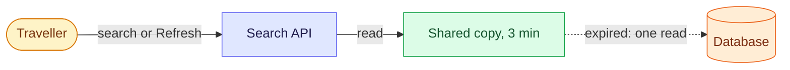
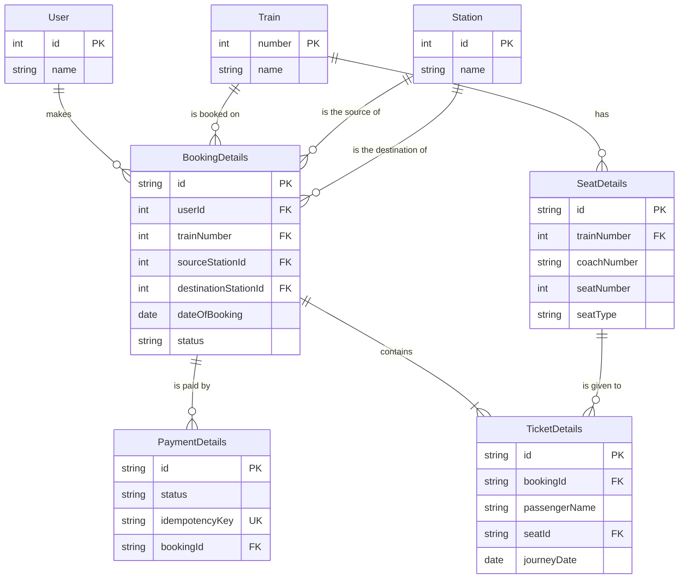

# Design a Train Ticket Booking System

The hard part is not booking one seat. It is thousands of people fighting for the same seat in the same minute, without ever selling it twice or losing a payment.

> [!TIP]
> - **Scope:** search availability and book a seat (hold, pay, confirm). Tatkal comes last as a non-functional topic, and cancel is out.
> - **Design:** a shared 3-minute copy serves search, a guarded 5-minute hold serves booking, and the payment key comes from the hold id. For Tatkal, a gateway rate limit and a Redis seat claim take the crowd, and the database unique rule stays the final guard.
> - **Trade-off:** a stale "available" on the search screen is allowed, but a seat is never sold twice.

## The design on one canvas

````excalidraw
layout: grid 3
gap: 90

```skeleton title="Scope"
[
  {"type":"rectangle","id":"sc1","x":0,"y":0,"width":400,"height":56,"backgroundColor":"#dcfce7","strokeColor":"#16a34a","fillStyle":"solid","roundness":{"type":3},"label":{"text":"IN: search seat availability","fontSize":16,"strokeColor":"#14532d"}},
  {"type":"rectangle","id":"sc2","x":0,"y":70,"width":400,"height":76,"backgroundColor":"#dcfce7","strokeColor":"#16a34a","fillStyle":"solid","roundness":{"type":3},"label":{"text":"IN: book a seat\nhold, pay, confirm","fontSize":16,"strokeColor":"#14532d"}},
  {"type":"rectangle","id":"sc3","x":0,"y":160,"width":400,"height":76,"backgroundColor":"#fef3c7","strokeColor":"#d97706","fillStyle":"solid","roundness":{"type":3},"label":{"text":"LAST, now covered: Tatkal under\npeak load (decisions 13 to 16)","fontSize":16,"strokeColor":"#78350f"}},
  {"type":"rectangle","id":"sc4","x":0,"y":250,"width":400,"height":76,"backgroundColor":"#fee2e2","strokeColor":"#dc2626","fillStyle":"solid","roundness":{"type":3},"label":{"text":"OUT: cancel and refund, accounts,\ntimetable admin, waitlist, fares","fontSize":16,"strokeColor":"#7f1d1d"}},
  {"type":"rectangle","id":"sc5","x":0,"y":340,"width":400,"height":76,"backgroundColor":"#ffedd5","strokeColor":"#ea580c","fillStyle":"solid","roundness":{"type":3},"label":{"text":"LATER: seats are sold for the whole\nroute for now (no segments)","fontSize":16,"strokeColor":"#7c2d12"}}
]
```

```skeleton title="Numbers"
[
  {"type":"rectangle","id":"nu1","x":0,"y":0,"width":400,"height":76,"backgroundColor":"#e0e7ff","strokeColor":"#6366f1","fillStyle":"solid","roundness":{"type":3},"label":{"text":"1,000 trains x 1,000 seats\n= 1M seats a day","fontSize":16,"strokeColor":"#1e1b4b"}},
  {"type":"rectangle","id":"nu2","x":0,"y":90,"width":400,"height":76,"backgroundColor":"#e0e7ff","strokeColor":"#6366f1","fillStyle":"solid","roundness":{"type":3},"label":{"text":"about 12 bookings a second on\naverage (1M / 86,400 s)","fontSize":16,"strokeColor":"#1e1b4b"}},
  {"type":"rectangle","id":"nu3","x":0,"y":180,"width":400,"height":76,"backgroundColor":"#e0e7ff","strokeColor":"#6366f1","fillStyle":"solid","roundness":{"type":3},"label":{"text":"about 1,160 searches a second\non average (100 per booking)","fontSize":16,"strokeColor":"#1e1b4b"}},
  {"type":"rectangle","id":"nu4","x":0,"y":270,"width":400,"height":96,"backgroundColor":"#fee2e2","strokeColor":"#dc2626","fillStyle":"solid","roundness":{"type":3},"label":{"text":"Tatkal minute: 100,000 users =\n1,700 attempts, 5,000 requests\na second, ~100 people per seat","fontSize":16,"strokeColor":"#7f1d1d"}}
]
```

```skeleton title="Architecture"
[
  {"type":"rectangle","id":"cli","x":0,"y":100,"width":240,"height":220,"strokeStyle":"dashed","strokeColor":"#868e96","backgroundColor":"transparent","roundness":{"type":3}},
  {"type":"text","x":50,"y":112,"text":"Traveller's app","fontSize":15},
  {"type":"rectangle","id":"app","x":30,"y":150,"width":180,"height":110,"backgroundColor":"#fef3c7","strokeColor":"#d97706","fillStyle":"solid","roundness":{"type":3},"label":{"text":"Client App\nsearch, book, pay","fontSize":16,"strokeColor":"#78350f"}},
  {"type":"rectangle","id":"gw","x":330,"y":40,"width":170,"height":440,"backgroundColor":"#e0e7ff","strokeColor":"#6366f1","fillStyle":"solid","roundness":{"type":3},"label":{"text":"Load balancer\nand API gateway\n\nauthentication\nrate limit\n(user + IP)\nrouting","fontSize":16,"strokeColor":"#1e1b4b"}},
  {"type":"rectangle","id":"search","x":640,"y":20,"width":190,"height":90,"backgroundColor":"#e0e7ff","strokeColor":"#6366f1","fillStyle":"solid","roundness":{"type":3},"label":{"text":"Search Service\nreads the copy","fontSize":16,"strokeColor":"#1e1b4b"}},
  {"type":"rectangle","id":"book","x":640,"y":200,"width":190,"height":110,"backgroundColor":"#e0e7ff","strokeColor":"#6366f1","fillStyle":"solid","roundness":{"type":3},"label":{"text":"Booking Service\nhold, pay, confirm","fontSize":16,"strokeColor":"#1e1b4b"}},
  {"type":"rectangle","id":"mer","x":640,"y":560,"width":190,"height":110,"strokeStyle":"dashed","backgroundColor":"#ffedd5","strokeColor":"#ea580c","fillStyle":"solid","roundness":{"type":3},"label":{"text":"Merchant\n(payment, outside)","fontSize":16,"strokeColor":"#7c2d12"}},
  {"type":"ellipse","id":"copy","x":1000,"y":10,"width":210,"height":110,"backgroundColor":"#dcfce7","strokeColor":"#16a34a","fillStyle":"solid","label":{"text":"Shared copy\n3 min","fontSize":16,"strokeColor":"#14532d"}},
  {"type":"ellipse","id":"redis","x":1000,"y":200,"width":210,"height":110,"backgroundColor":"#dcfce7","strokeColor":"#16a34a","fillStyle":"solid","label":{"text":"Redis\nseat claims","fontSize":16,"strokeColor":"#14532d"}},
  {"type":"ellipse","id":"db","x":1000,"y":360,"width":210,"height":130,"backgroundColor":"#ffedd5","strokeColor":"#ea580c","fillStyle":"solid","label":{"text":"Database\nseats, bookings,\npayments","fontSize":16,"strokeColor":"#7c2d12"}},
  {"type":"rectangle","id":"jobs","x":1000,"y":560,"width":210,"height":110,"backgroundColor":"#fef3c7","strokeColor":"#d97706","fillStyle":"solid","roundness":{"type":3},"label":{"text":"Expiry and\nrefund jobs","fontSize":16,"strokeColor":"#78350f"}},
  {"type":"arrow","x":210,"y":205,"points":[[0,0],[120,0]],"startArrowhead":"arrow","endArrowhead":"arrow","label":{"text":"HTTPS","fontSize":14}},
  {"type":"arrow","x":500,"y":65,"points":[[0,0],[140,0]],"label":{"text":"search","fontSize":14}},
  {"type":"arrow","x":500,"y":255,"points":[[0,0],[140,0]],"label":{"text":"book, pay","fontSize":14}},
  {"type":"arrow","x":830,"y":65,"points":[[0,0],[170,0]],"label":{"text":"read","fontSize":14}},
  {"type":"arrow","x":830,"y":255,"points":[[0,0],[170,0]],"label":{"text":"claim seat","fontSize":14}},
  {"type":"arrow","x":830,"y":290,"points":[[0,0],[170,135]],"label":{"text":"write","fontSize":14}},
  {"type":"arrow","x":690,"y":310,"points":[[0,0],[0,250]],"label":{"text":"pay (hold id)","fontSize":14}},
  {"type":"arrow","x":790,"y":560,"points":[[0,0],[0,-250]],"strokeStyle":"dashed","label":{"text":"callback","fontSize":14}},
  {"type":"arrow","x":1000,"y":615,"points":[[0,0],[-170,0]],"label":{"text":"refund","fontSize":14}},
  {"type":"arrow","x":1105,"y":560,"points":[[0,0],[0,-70]],"label":{"text":"mark EXPIRED","fontSize":14}},
  {"type":"text","x":1230,"y":40,"text":"refilled from the DB\nwhen it expires","fontSize":14},
  {"type":"text","x":1230,"y":225,"text":"SET key hold-id NX EX 300\none winner per seat","fontSize":14},
  {"type":"text","x":1230,"y":395,"text":"unique (seat, journey date)\nis the final guard","fontSize":14},
  {"type":"text","x":380,"y":600,"text":"PENDING or too late:\ncancel and refund","fontSize":14}
]
```



```skeleton title="Booking flow"
[
  {"type":"rectangle","id":"bf1","x":0,"y":190,"width":110,"height":70,"backgroundColor":"#fef3c7","strokeColor":"#d97706","fillStyle":"solid","roundness":{"type":3},"label":{"text":"Traveller","fontSize":16,"strokeColor":"#78350f"}},
  {"type":"rectangle","id":"bf2","x":205,"y":190,"width":140,"height":70,"backgroundColor":"#fef3c7","strokeColor":"#d97706","fillStyle":"solid","roundness":{"type":3},"label":{"text":"Gateway\nrate limit","fontSize":16,"strokeColor":"#78350f"}},
  {"type":"ellipse","id":"bf3","x":440,"y":180,"width":160,"height":90,"backgroundColor":"#dcfce7","strokeColor":"#16a34a","fillStyle":"solid","label":{"text":"Redis\nseat claim","fontSize":16,"strokeColor":"#14532d"}},
  {"type":"rectangle","id":"bf4","x":695,"y":190,"width":140,"height":70,"backgroundColor":"#e0e7ff","strokeColor":"#6366f1","fillStyle":"solid","roundness":{"type":3},"label":{"text":"Hold\n5 min","fontSize":16,"strokeColor":"#1e1b4b"}},
  {"type":"ellipse","id":"bf5","x":695,"y":0,"width":140,"height":90,"backgroundColor":"#ffedd5","strokeColor":"#ea580c","fillStyle":"solid","label":{"text":"Database","fontSize":16,"strokeColor":"#7c2d12"}},
  {"type":"rectangle","id":"bf6","x":420,"y":10,"width":150,"height":70,"backgroundColor":"#fef3c7","strokeColor":"#d97706","fillStyle":"solid","roundness":{"type":3},"label":{"text":"Lazy step\n+ job","fontSize":16,"strokeColor":"#78350f"}},
  {"type":"rectangle","id":"bf7","x":695,"y":380,"width":140,"height":70,"strokeStyle":"dashed","backgroundColor":"#ffedd5","strokeColor":"#ea580c","fillStyle":"solid","roundness":{"type":3},"label":{"text":"Merchant","fontSize":16,"strokeColor":"#7c2d12"}},
  {"type":"rectangle","id":"bf8","x":420,"y":380,"width":150,"height":70,"backgroundColor":"#fef3c7","strokeColor":"#d97706","fillStyle":"solid","roundness":{"type":3},"label":{"text":"Refund job","fontSize":16,"strokeColor":"#78350f"}},
  {"type":"rectangle","id":"bf9","x":930,"y":300,"width":150,"height":60,"backgroundColor":"#dcfce7","strokeColor":"#16a34a","fillStyle":"solid","roundness":{"type":3},"label":{"text":"CONFIRMED\nthen email","fontSize":15,"strokeColor":"#14532d"}},
  {"type":"rectangle","id":"bf10","x":930,"y":385,"width":150,"height":60,"backgroundColor":"#fee2e2","strokeColor":"#dc2626","fillStyle":"solid","roundness":{"type":3},"label":{"text":"Refund,\nEXPIRED","fontSize":15,"strokeColor":"#7f1d1d"}},
  {"type":"rectangle","id":"bf11","x":930,"y":470,"width":170,"height":60,"backgroundColor":"#fee2e2","strokeColor":"#dc2626","fillStyle":"solid","roundness":{"type":3},"label":{"text":"Cancel ticket,\nrefund","fontSize":15,"strokeColor":"#7f1d1d"}},
  {"type":"arrow","x":110,"y":225,"points":[[0,0],[95,0]],"label":{"text":"book + key","fontSize":14}},
  {"type":"arrow","x":345,"y":225,"points":[[0,0],[95,0]]},
  {"type":"arrow","x":600,"y":225,"points":[[0,0],[95,0]],"label":{"text":"winner only","fontSize":14}},
  {"type":"arrow","x":765,"y":190,"points":[[0,0],[0,-100]],"label":{"text":"unique insert","fontSize":14}},
  {"type":"arrow","x":570,"y":45,"points":[[0,0],[125,0]],"strokeStyle":"dashed","label":{"text":"mark EXPIRED","fontSize":14}},
  {"type":"arrow","x":765,"y":260,"points":[[0,0],[0,120]],"label":{"text":"hold id = key","fontSize":14}},
  {"type":"arrow","x":570,"y":415,"points":[[0,0],[125,0]],"strokeStyle":"dashed","label":{"text":"retry refund","fontSize":14}},
  {"type":"arrow","x":835,"y":415,"points":[[0,0],[95,-85]],"label":{"text":"in time","fontSize":14}},
  {"type":"arrow","x":835,"y":415,"points":[[0,0],[95,0]],"label":{"text":"too late","fontSize":14}},
  {"type":"arrow","x":835,"y":415,"points":[[0,0],[95,85]],"label":{"text":"PENDING","fontSize":14}}
]
```

```skeleton title="Statuses"
[
  {"type":"text","x":0,"y":0,"text":"Booking status","fontSize":16},
  {"type":"rectangle","id":"st1","x":0,"y":140,"width":130,"height":60,"backgroundColor":"#e0e7ff","strokeColor":"#6366f1","fillStyle":"solid","roundness":{"type":3},"label":{"text":"Ticket\nHELD","fontSize":16,"strokeColor":"#1e1b4b"}},
  {"type":"rectangle","id":"st2","x":300,"y":40,"width":150,"height":60,"backgroundColor":"#dcfce7","strokeColor":"#16a34a","fillStyle":"solid","roundness":{"type":3},"label":{"text":"CONFIRMED","fontSize":16,"strokeColor":"#14532d"}},
  {"type":"rectangle","id":"st3","x":300,"y":140,"width":150,"height":60,"backgroundColor":"#fee2e2","strokeColor":"#dc2626","fillStyle":"solid","roundness":{"type":3},"label":{"text":"EXPIRED","fontSize":16,"strokeColor":"#7f1d1d"}},
  {"type":"rectangle","id":"st4","x":300,"y":240,"width":150,"height":60,"backgroundColor":"#fee2e2","strokeColor":"#dc2626","fillStyle":"solid","roundness":{"type":3},"label":{"text":"CANCELLED","fontSize":16,"strokeColor":"#7f1d1d"}},
  {"type":"text","x":0,"y":350,"text":"Payment status","fontSize":16},
  {"type":"rectangle","id":"st5","x":0,"y":400,"width":170,"height":60,"backgroundColor":"#e0e7ff","strokeColor":"#6366f1","fillStyle":"solid","roundness":{"type":3},"label":{"text":"Payment\nSUCCESSFUL","fontSize":16,"strokeColor":"#1e1b4b"}},
  {"type":"rectangle","id":"st6","x":0,"y":520,"width":170,"height":60,"backgroundColor":"#e0e7ff","strokeColor":"#6366f1","fillStyle":"solid","roundness":{"type":3},"label":{"text":"Payment\nPENDING","fontSize":16,"strokeColor":"#1e1b4b"}},
  {"type":"rectangle","id":"st7","x":330,"y":520,"width":180,"height":60,"backgroundColor":"#fef3c7","strokeColor":"#d97706","fillStyle":"solid","roundness":{"type":3},"label":{"text":"REFUND_PENDING","fontSize":16,"strokeColor":"#78350f"}},
  {"type":"rectangle","id":"st8","x":690,"y":440,"width":150,"height":110,"backgroundColor":"#fef3c7","strokeColor":"#d97706","fillStyle":"solid","roundness":{"type":3},"label":{"text":"REFUNDED","fontSize":16,"strokeColor":"#78350f"}},
  {"type":"arrow","x":130,"y":170,"points":[[0,0],[170,-100]],"label":{"text":"paid in time","fontSize":14}},
  {"type":"arrow","x":130,"y":170,"points":[[0,0],[170,0]],"label":{"text":"not paid in time","fontSize":14}},
  {"type":"arrow","x":130,"y":170,"points":[[0,0],[170,100]],"label":{"text":"callback PENDING","fontSize":14}},
  {"type":"arrow","x":170,"y":430,"points":[[0,0],[520,25]],"label":{"text":"booking already EXPIRED","fontSize":14}},
  {"type":"arrow","x":170,"y":550,"points":[[0,0],[160,0]],"label":{"text":"ticket cancelled","fontSize":14}},
  {"type":"arrow","x":510,"y":550,"points":[[0,0],[180,-50]],"label":{"text":"job retries","fontSize":14}}
]
```

```skeleton title="API"
[
  {"type":"rectangle","id":"ap1","x":0,"y":0,"width":500,"height":92,"backgroundColor":"#e0e7ff","strokeColor":"#6366f1","fillStyle":"solid","roundness":{"type":3},"label":{"text":"GET /api/v1/search\nsource, destination, date, class\n-> available or not (shared copy)","fontSize":15,"strokeColor":"#1e1b4b"}},
  {"type":"rectangle","id":"ap2","x":0,"y":106,"width":500,"height":92,"backgroundColor":"#e0e7ff","strokeColor":"#6366f1","fillStyle":"solid","roundness":{"type":3},"label":{"text":"POST /api/v1/availability/refresh\ntrain, date, class\n-> the shared copy (a read)","fontSize":15,"strokeColor":"#1e1b4b"}},
  {"type":"rectangle","id":"ap3","x":0,"y":212,"width":500,"height":92,"backgroundColor":"#e0e7ff","strokeColor":"#6366f1","fillStyle":"solid","roundness":{"type":3},"label":{"text":"POST /api/v1/book-tickets\nidempotency key, passengers, train,\ndate, class -> hold id + expiry","fontSize":15,"strokeColor":"#1e1b4b"}},
  {"type":"rectangle","id":"ap4","x":0,"y":318,"width":500,"height":92,"backgroundColor":"#ffedd5","strokeColor":"#ea580c","fillStyle":"solid","roundness":{"type":3},"label":{"text":"POST /api/v1/payment\nhold id = the merchant's key\n-> starts the payment","fontSize":15,"strokeColor":"#7c2d12"}},
  {"type":"rectangle","id":"ap5","x":0,"y":424,"width":500,"height":112,"backgroundColor":"#ffedd5","strokeColor":"#ea580c","fillStyle":"solid","roundness":{"type":3},"label":{"text":"POST /api/v1/confirm-ticket\nmerchant callback: key + status\nSUCCESSFUL, FAILED or PENDING\n(signed and idempotent)","fontSize":15,"strokeColor":"#7c2d12"}}
]
```



```skeleton title="Decisions"
[
  {"type":"rectangle","id":"d01","x":0,"y":0,"width":430,"height":92,"backgroundColor":"#dcfce7","strokeColor":"#16a34a","fillStyle":"solid","roundness":{"type":3},"label":{"text":"1. Scope: search + booking first,\nTatkal last, cancel out","fontSize":15,"strokeColor":"#14532d"}},
  {"type":"rectangle","id":"d02","x":450,"y":0,"width":430,"height":92,"backgroundColor":"#dcfce7","strokeColor":"#16a34a","fillStyle":"solid","roundness":{"type":3},"label":{"text":"2. Search = shared copy, 3 min: one DB\nread per key, not per user. Refresh\nreturns the same copy","fontSize":15,"strokeColor":"#14532d"}},
  {"type":"rectangle","id":"d03","x":0,"y":106,"width":430,"height":72,"backgroundColor":"#dcfce7","strokeColor":"#16a34a","fillStyle":"solid","roundness":{"type":3},"label":{"text":"3. Hold on Book, not on page open.\nExpires after 5 minutes","fontSize":15,"strokeColor":"#14532d"}},
  {"type":"rectangle","id":"d04","x":450,"y":106,"width":430,"height":72,"backgroundColor":"#dcfce7","strokeColor":"#16a34a","fillStyle":"solid","roundness":{"type":3},"label":{"text":"4. Merchant key = hold id: a double\nclick on Pay charges once","fontSize":15,"strokeColor":"#14532d"}},
  {"type":"rectangle","id":"d05","x":0,"y":192,"width":430,"height":92,"backgroundColor":"#dcfce7","strokeColor":"#16a34a","fillStyle":"solid","roundness":{"type":3},"label":{"text":"5. Browser key per booking attempt:\nunique constraint, so a repeat returns\nthe same hold","fontSize":15,"strokeColor":"#14532d"}},
  {"type":"rectangle","id":"d06","x":450,"y":192,"width":430,"height":92,"backgroundColor":"#dcfce7","strokeColor":"#16a34a","fillStyle":"solid","roundness":{"type":3},"label":{"text":"6. Seat taken = an active ticket row.\nUnique (seat, journey date) over\nHELD and CONFIRMED","fontSize":15,"strokeColor":"#14532d"}},
  {"type":"rectangle","id":"d07","x":0,"y":298,"width":430,"height":72,"backgroundColor":"#dcfce7","strokeColor":"#16a34a","fillStyle":"solid","roundness":{"type":3},"label":{"text":"7. Expired hold keeps its row, marked\nEXPIRED (history kept)","fontSize":15,"strokeColor":"#14532d"}},
  {"type":"rectangle","id":"d08","x":450,"y":298,"width":430,"height":72,"backgroundColor":"#dcfce7","strokeColor":"#16a34a","fillStyle":"solid","roundness":{"type":3},"label":{"text":"8. Expiry: a lazy step on the wanted\nseat + a job for the rest","fontSize":15,"strokeColor":"#14532d"}},
  {"type":"rectangle","id":"d09","x":0,"y":384,"width":430,"height":92,"backgroundColor":"#dcfce7","strokeColor":"#16a34a","fillStyle":"solid","roundness":{"type":3},"label":{"text":"9. Late payment: refund. Guarded confirm;\nbooking EXPIRED, payment SUCCESSFUL\nthen REFUNDED","fontSize":15,"strokeColor":"#14532d"}},
  {"type":"rectangle","id":"d10","x":450,"y":384,"width":430,"height":72,"backgroundColor":"#dcfce7","strokeColor":"#16a34a","fillStyle":"solid","roundness":{"type":3},"label":{"text":"10. Stations are a table (id, name);\nsource and destination are FKs","fontSize":15,"strokeColor":"#14532d"}},
  {"type":"rectangle","id":"d11","x":0,"y":490,"width":880,"height":92,"backgroundColor":"#dcfce7","strokeColor":"#16a34a","fillStyle":"solid","roundness":{"type":3},"label":{"text":"11. Callback PENDING: cancel the ticket, free the seat, send the refund\nto the merchant even if the money was taken. No waiting: the seat\nis worth more than a slow bank","fontSize":15,"strokeColor":"#14532d"}},
  {"type":"rectangle","id":"d12","x":0,"y":596,"width":880,"height":92,"backgroundColor":"#dcfce7","strokeColor":"#16a34a","fillStyle":"solid","roundness":{"type":3},"label":{"text":"12. Refund fails: saga compensation. Payment = REFUND_PENDING (the saved\nstatus is the retry queue); a periodic job retries with the same refund key\nso a retry never refunds twice","fontSize":15,"strokeColor":"#14532d"}},
  {"type":"rectangle","id":"d13","x":0,"y":702,"width":880,"height":92,"backgroundColor":"#dcfce7","strokeColor":"#16a34a","fillStyle":"solid","roundness":{"type":3},"label":{"text":"13. Bots: a rate limiter in the gateway, before the app. Per user and per IP,\nsliding window, so one user cannot flood book-tickets","fontSize":15,"strokeColor":"#14532d"}},
  {"type":"rectangle","id":"d14","x":0,"y":808,"width":880,"height":92,"backgroundColor":"#dcfce7","strokeColor":"#16a34a","fillStyle":"solid","roundness":{"type":3},"label":{"text":"14. Held seats per user: one booking at a time in the Tatkal window, as IRCTC does.\nA booking can carry several passengers. Enforced in the database like seats,\nso two browser tabs cannot both win","fontSize":15,"strokeColor":"#14532d"}},
  {"type":"rectangle","id":"d15","x":0,"y":914,"width":880,"height":112,"backgroundColor":"#dcfce7","strokeColor":"#16a34a","fillStyle":"solid","roundness":{"type":3},"label":{"text":"15. Tatkal: Redis takes the crowd. One command claims a seat:\nSET seat-key hold-id NX EX 300 (the claim expires with the hold).\nOnly winners write to the database. A replica takes over if Redis dies,\nbut it copies late, so the last claims can be lost","fontSize":15,"strokeColor":"#14532d"}},
  {"type":"rectangle","id":"d16","x":0,"y":1040,"width":880,"height":92,"backgroundColor":"#dcfce7","strokeColor":"#16a34a","fillStyle":"solid","roundness":{"type":3},"label":{"text":"16. Final guard: the unique (seat, journey date) rule in the database. Redis is a fast\nfilter, not the source of truth. The losing user sees 'seat taken' at Book, before\npaying, so there is nothing to refund","fontSize":15,"strokeColor":"#14532d"}}
]
```

link: Numbers -> Architecture "sizes the design"
link: Search path -> Booking flow "then book"
link: Booking flow -> Statuses "ticket and payment states"
link: API -> Data model "the tables behind them"
````

Open it full screen with the expand button, then zoom and pan. Every decision will live on this canvas as it grows. The long written version, with all the tables, is kept in [Train Ticket Booking: the written version](/notebook/whiteboard/train-ticket-booking-written).
