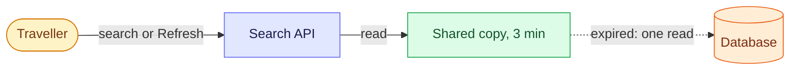
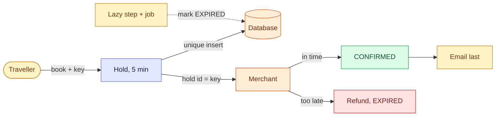
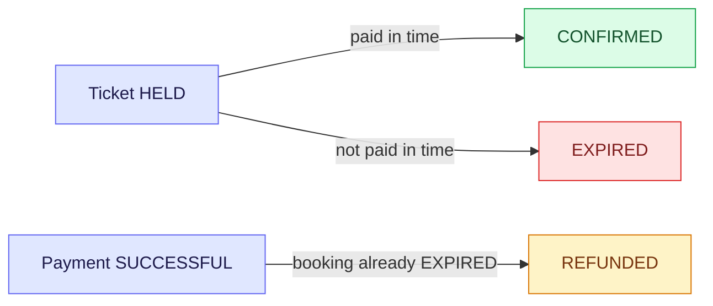
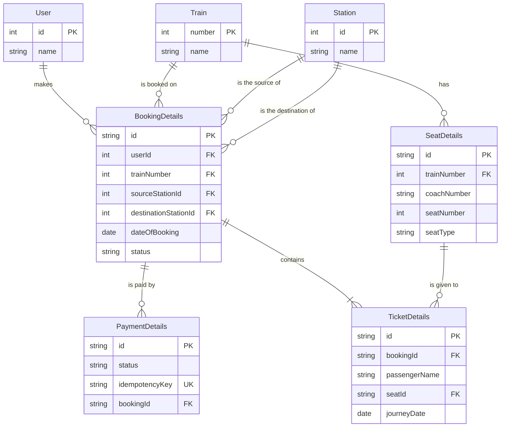

# Design a Train Ticket Booking System

The hard part is not booking one seat. It is thousands of people fighting for the same seat in the same minute, without ever selling it twice or losing a payment.

> [!TIP]
> - **Scope:** search availability and book a seat (hold, pay, confirm). Tatkal comes last as a non-functional topic, and cancel is out.
> - **Design:** a shared 3-minute copy serves search, a guarded 5-minute hold serves booking, and the payment key comes from the hold id.
> - **Trade-off:** a stale "available" on the search screen is allowed, but a seat is never sold twice.

## The design on one canvas

````excalidraw
layout: grid 3
gap: 90

```skeleton title="Scope"
[
  {"type":"rectangle","id":"sc1","x":0,"y":0,"width":400,"height":56,"backgroundColor":"#dcfce7","strokeColor":"#16a34a","fillStyle":"solid","roundness":{"type":3},"label":{"text":"IN: search seat availability","fontSize":16,"strokeColor":"#14532d"}},
  {"type":"rectangle","id":"sc2","x":0,"y":70,"width":400,"height":76,"backgroundColor":"#dcfce7","strokeColor":"#16a34a","fillStyle":"solid","roundness":{"type":3},"label":{"text":"IN: book a seat\nhold, pay, confirm","fontSize":16,"strokeColor":"#14532d"}},
  {"type":"rectangle","id":"sc3","x":0,"y":160,"width":400,"height":76,"backgroundColor":"#fef3c7","strokeColor":"#d97706","fillStyle":"solid","roundness":{"type":3},"label":{"text":"LAST: Tatkal, the same flow\nunder peak load","fontSize":16,"strokeColor":"#78350f"}},
  {"type":"rectangle","id":"sc4","x":0,"y":250,"width":400,"height":76,"backgroundColor":"#fee2e2","strokeColor":"#dc2626","fillStyle":"solid","roundness":{"type":3},"label":{"text":"OUT: cancel and refund, accounts,\ntimetable admin, waitlist, fares","fontSize":16,"strokeColor":"#7f1d1d"}}
]
```

```skeleton title="Numbers"
[
  {"type":"rectangle","id":"nu1","x":0,"y":0,"width":400,"height":76,"backgroundColor":"#e0e7ff","strokeColor":"#6366f1","fillStyle":"solid","roundness":{"type":3},"label":{"text":"1,000 trains x 1,000 seats\n= 1M seats a day","fontSize":16,"strokeColor":"#1e1b4b"}},
  {"type":"rectangle","id":"nu2","x":0,"y":90,"width":400,"height":76,"backgroundColor":"#e0e7ff","strokeColor":"#6366f1","fillStyle":"solid","roundness":{"type":3},"label":{"text":"about 12 bookings a second on\naverage (1M / 86,400 s)","fontSize":16,"strokeColor":"#1e1b4b"}},
  {"type":"rectangle","id":"nu3","x":0,"y":180,"width":400,"height":76,"backgroundColor":"#e0e7ff","strokeColor":"#6366f1","fillStyle":"solid","roundness":{"type":3},"label":{"text":"about 1,160 searches a second\non average (100 per booking)","fontSize":16,"strokeColor":"#1e1b4b"}},
  {"type":"rectangle","id":"nu4","x":0,"y":270,"width":400,"height":96,"backgroundColor":"#fee2e2","strokeColor":"#dc2626","fillStyle":"solid","roundness":{"type":3},"label":{"text":"Tatkal minute: 100,000 users =\n1,700 attempts, 5,000 requests\na second, ~100 people per seat","fontSize":16,"strokeColor":"#7f1d1d"}}
]
```

```skeleton title="Open questions"
[
  {"type":"rectangle","id":"oq1","x":0,"y":0,"width":400,"height":96,"backgroundColor":"#ffedd5","strokeColor":"#ea580c","fillStyle":"solid","roundness":{"type":3},"label":{"text":"Merchant callback says PENDING:\nwait, ask the merchant or refund?\nand for how long?","fontSize":16,"strokeColor":"#7c2d12"}},
  {"type":"rectangle","id":"oq2","x":0,"y":110,"width":400,"height":76,"backgroundColor":"#ffedd5","strokeColor":"#ea580c","fillStyle":"solid","roundness":{"type":3},"label":{"text":"How many active holds may one\nuser have? (bots)","fontSize":16,"strokeColor":"#7c2d12"}},
  {"type":"rectangle","id":"oq3","x":0,"y":200,"width":400,"height":96,"backgroundColor":"#ffedd5","strokeColor":"#ea580c","fillStyle":"solid","roundness":{"type":3},"label":{"text":"Tatkal: how does the booking path\ntake the full crowd?\n(the last topic)","fontSize":16,"strokeColor":"#7c2d12"}},
  {"type":"rectangle","id":"oq4","x":0,"y":310,"width":400,"height":76,"backgroundColor":"#ffedd5","strokeColor":"#ea580c","fillStyle":"solid","roundness":{"type":3},"label":{"text":"Seats are sold for the whole route\nfor now (no segments)","fontSize":16,"strokeColor":"#7c2d12"}}
]
```







```skeleton title="API"
[
  {"type":"rectangle","id":"ap1","x":0,"y":0,"width":500,"height":92,"backgroundColor":"#e0e7ff","strokeColor":"#6366f1","fillStyle":"solid","roundness":{"type":3},"label":{"text":"GET /api/v1/search\nsource, destination, date, class\n-> available or not (shared copy)","fontSize":15,"strokeColor":"#1e1b4b"}},
  {"type":"rectangle","id":"ap2","x":0,"y":106,"width":500,"height":92,"backgroundColor":"#e0e7ff","strokeColor":"#6366f1","fillStyle":"solid","roundness":{"type":3},"label":{"text":"POST /api/v1/availability/refresh\ntrain, date, class\n-> the shared copy (a read)","fontSize":15,"strokeColor":"#1e1b4b"}},
  {"type":"rectangle","id":"ap3","x":0,"y":212,"width":500,"height":92,"backgroundColor":"#e0e7ff","strokeColor":"#6366f1","fillStyle":"solid","roundness":{"type":3},"label":{"text":"POST /api/v1/book-tickets\nidempotency key, passengers, train,\ndate, class -> hold id + expiry","fontSize":15,"strokeColor":"#1e1b4b"}},
  {"type":"rectangle","id":"ap4","x":0,"y":318,"width":500,"height":92,"backgroundColor":"#ffedd5","strokeColor":"#ea580c","fillStyle":"solid","roundness":{"type":3},"label":{"text":"POST /api/v1/payment\nhold id = the merchant's key\n-> starts the payment","fontSize":15,"strokeColor":"#7c2d12"}},
  {"type":"rectangle","id":"ap5","x":0,"y":424,"width":500,"height":112,"backgroundColor":"#ffedd5","strokeColor":"#ea580c","fillStyle":"solid","roundness":{"type":3},"label":{"text":"POST /api/v1/confirm-ticket\nmerchant callback: key + status\nSUCCESSFUL, FAILED or PENDING\n(signed and idempotent)","fontSize":15,"strokeColor":"#7c2d12"}}
]
```



```skeleton title="Decisions"
[
  {"type":"rectangle","id":"d01","x":0,"y":0,"width":430,"height":92,"backgroundColor":"#dcfce7","strokeColor":"#16a34a","fillStyle":"solid","roundness":{"type":3},"label":{"text":"1. Scope: search + booking first,\nTatkal last, cancel out","fontSize":15,"strokeColor":"#14532d"}},
  {"type":"rectangle","id":"d02","x":450,"y":0,"width":430,"height":92,"backgroundColor":"#dcfce7","strokeColor":"#16a34a","fillStyle":"solid","roundness":{"type":3},"label":{"text":"2. Search = shared copy, 3 min: one DB\nread per key, not per user. Refresh\nreturns the same copy","fontSize":15,"strokeColor":"#14532d"}},
  {"type":"rectangle","id":"d03","x":0,"y":106,"width":430,"height":72,"backgroundColor":"#dcfce7","strokeColor":"#16a34a","fillStyle":"solid","roundness":{"type":3},"label":{"text":"3. Hold on Book, not on page open.\nExpires after 5 minutes","fontSize":15,"strokeColor":"#14532d"}},
  {"type":"rectangle","id":"d04","x":450,"y":106,"width":430,"height":72,"backgroundColor":"#dcfce7","strokeColor":"#16a34a","fillStyle":"solid","roundness":{"type":3},"label":{"text":"4. Merchant key = hold id: a double\nclick on Pay charges once","fontSize":15,"strokeColor":"#14532d"}},
  {"type":"rectangle","id":"d05","x":0,"y":192,"width":430,"height":92,"backgroundColor":"#dcfce7","strokeColor":"#16a34a","fillStyle":"solid","roundness":{"type":3},"label":{"text":"5. Browser key per booking attempt:\nunique constraint, so a repeat returns\nthe same hold","fontSize":15,"strokeColor":"#14532d"}},
  {"type":"rectangle","id":"d06","x":450,"y":192,"width":430,"height":92,"backgroundColor":"#dcfce7","strokeColor":"#16a34a","fillStyle":"solid","roundness":{"type":3},"label":{"text":"6. Seat taken = an active ticket row.\nUnique (seat, journey date) over\nHELD and CONFIRMED","fontSize":15,"strokeColor":"#14532d"}},
  {"type":"rectangle","id":"d07","x":0,"y":298,"width":430,"height":72,"backgroundColor":"#dcfce7","strokeColor":"#16a34a","fillStyle":"solid","roundness":{"type":3},"label":{"text":"7. Expired hold keeps its row, marked\nEXPIRED (history kept)","fontSize":15,"strokeColor":"#14532d"}},
  {"type":"rectangle","id":"d08","x":450,"y":298,"width":430,"height":72,"backgroundColor":"#dcfce7","strokeColor":"#16a34a","fillStyle":"solid","roundness":{"type":3},"label":{"text":"8. Expiry: a lazy step on the wanted\nseat + a job for the rest","fontSize":15,"strokeColor":"#14532d"}},
  {"type":"rectangle","id":"d09","x":0,"y":384,"width":430,"height":92,"backgroundColor":"#dcfce7","strokeColor":"#16a34a","fillStyle":"solid","roundness":{"type":3},"label":{"text":"9. Late payment: refund. Guarded confirm;\nbooking EXPIRED, payment SUCCESSFUL\nthen REFUNDED","fontSize":15,"strokeColor":"#14532d"}},
  {"type":"rectangle","id":"d10","x":450,"y":384,"width":430,"height":72,"backgroundColor":"#dcfce7","strokeColor":"#16a34a","fillStyle":"solid","roundness":{"type":3},"label":{"text":"10. Stations are a table (id, name);\nsource and destination are FKs","fontSize":15,"strokeColor":"#14532d"}}
]
```

link: Search path -> Booking flow "then book"
link: Booking flow -> Statuses "ticket and payment states"
link: API -> Data model "the tables behind them"
````

Open it full screen with the expand button, then zoom and pan. Every decision will live on this canvas as it grows. The long written version, with all the tables, is kept in [Train Ticket Booking: the written version](/notebook/whiteboard/train-ticket-booking-written).
